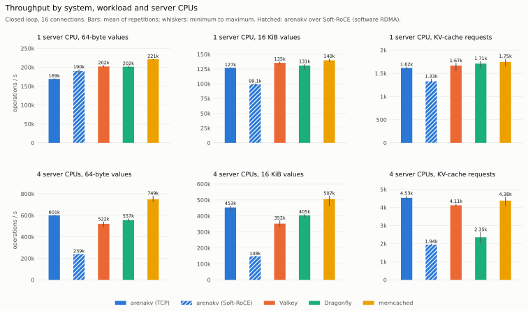
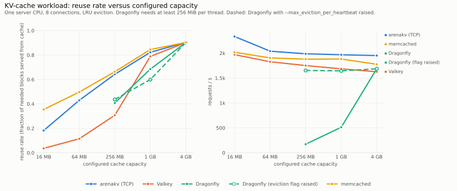

# rdmakit

RDMA software in C, with the components measured against established systems:

- **`rdmaduct`**: a message transport over RDMA reliable connections or TCP.
- **`arenakv`**: a key-value cache for large blocks, built on that transport.
- **`kvpace`**: a load generator that drives `arenakv` and the established servers with the same code.

| Project | What it is | Status | Documentation |
|---|---|---|---|
| [`rdmaduct`](rdmaduct) | message transport over RDMA reliable connections or TCP, one API, identical behavior | experimental | [README](rdmaduct/README.md), [architecture](rdmaduct/docs/ARCHITECTURE.md) |
| [`arenakv`](arenakv) | key-value cache for large values: log-structured engine, server, client library | experimental, not for production | [README](arenakv/README.md), [architecture](arenakv/docs/ARCHITECTURE.md), [protocol](arenakv/docs/PROTOCOL.md), [operations](arenakv/docs/OPERATIONS.md) |
| [`kvpace`](kvpace) | load generator: closed and open loop, pipelining, YCSB presets, TLS; RESP, memcached and native protocols; KV-cache scenario | experimental | [README](kvpace/README.md), [usage](kvpace/docs/USAGE.md), [architecture](kvpace/docs/ARCHITECTURE.md) |
| [`benchmarks`](benchmarks) | orchestrator, raw data, figures, tables, methodology, machine-checked claims | | [README](benchmarks/README.md), [methodology](benchmarks/METHODOLOGY.md) |
| [`lab`](lab) | six programs that teach RDMA programming, from opening a device to a key-value store over one-sided reads | | [README](lab/README.md) |

The three projects live in one repository because they depend on each other: `arenakv` uses `rdmaduct` as its
transport, `kvpace` drives `arenakv` through its native protocol, and the benchmark suite needs all three. Each
project directory builds and tests on its own and has its own documentation.

## Why this repository exists

Two workloads that keep growing are poorly served by general-purpose caches. Model inference serving keeps
key-value cache blocks, and HPC pipelines stage intermediate data. Both write values of kilobytes to megabytes
that are rarely modified and read many times, and both often run on clusters with RDMA networks. The established
caches were designed for small objects over kernel TCP, and the established RDMA frameworks are large toolkits
whose behavior differs from one transport to another. Published comparisons are also hard to trust: numbers
differ between load generators as much as between servers, and the raw data is rarely available.

This repository addresses those three gaps with small implementations that can be read in an afternoon, plus
measurements that anyone can re-derive:

1. **A cache shaped for large blocks** (`arenakv`): log-structured memory, so a fixed-size block costs no
   per-object allocation. A vector-compared hash index and second-chance eviction, with a tested guarantee
   that a lookup never returns a stale value. It speaks the memcached and Redis protocols as well as its own
   native protocol over RDMA, so existing clients and tools can use it.
2. **A transport that is the same on RDMA and TCP** (`rdmaduct`): messages, one-sided reads, writes and atomics,
   and event-loop descriptors, with identical ordering, flow control and error semantics on both. Code developed on a laptop runs unchanged on an RDMA cluster.
3. **A measurement tool that removes the tool as a variable** (`kvpace`): one implementation drives all compared
   servers, measures open-loop latency from the intended send time, and models KV-cache reuse. Every published
   number is tied to raw data by a verifier.

None of these replaces the established systems for production use. [`docs/PRIOR_ART.md`](docs/PRIOR_ART.md) states
in detail what each project adds, what it lacks, and when to choose something else.

## Comparison with established systems

Statements about other systems reflect their public documentation at the time of writing.

### arenakv and general-purpose caches

| | arenakv | memcached | Valkey / Redis | Dragonfly |
|---|---|---|---|---|
| Target values | large, mostly immutable blocks | small to medium objects | data structures | data structures |
| Memory layout | log-structured arena per shard | slab allocator | per-object allocation (jemalloc) | per-object allocation (mimalloc) |
| Eviction | second chance in write order | segmented LRU | approximate LRU / LFU policies | cache mode (2Q-based) |
| Network transport | TCP, TLS, RDMA reliable connections | TCP, UDP, Unix sockets, TLS | TCP, Unix sockets, TLS | TCP, TLS |
| Protocols | memcached text and meta, RESP2, native binary ([PROTOCOL.md](arenakv/docs/PROTOCOL.md)) | text, meta, binary | RESP2, RESP3 | RESP2, RESP3, memcached text |
| Expiry, CAS, conditional stores, increments | yes | yes | yes | yes |
| Data types | strings | strings | strings, lists, hashes, sets, sorted sets, streams | as Valkey |
| Authentication | shared credentials file | SASL, ASCII auth | ACL users | ACL users |
| Persistence | snapshots | warm restart | RDB, AOF | snapshots |
| Replication, cluster | no (client-side consistent hashing) | no (client-side hashing) | yes | replication |
| Hash index | grows from a small size | grows | grows | grows |
| Source size | about 6,500 lines (engine, server, protocols, client) | large | large | large |
| Production use | not recommended | widely deployed | widely deployed | deployed |

### rdmaduct and RDMA communication frameworks

| | rdmaduct | UCX | libfabric |
|---|---|---|---|
| Programming model | two-sided messages, RMA read/write, atomics | tag matching, streams, active messages, RMA, atomics | messages, tagged messages, RMA, atomics |
| Transports | RDMA reliable connections (verbs + rdma_cm), TCP | many (verbs, shared memory, TCP, GPU) | many providers (verbs, TCP, shared memory, EFA, CXI) |
| Same semantics on every transport | yes; one test suite runs on both | capabilities depend on the transport | capabilities depend on the provider |
| Flow control | credit-based, tested against receiver-not-ready errors | internal | provider-specific |
| One-sided read/write, 64-bit atomics | yes (emulated on TCP) | yes | yes |
| Zero-copy send, pollable descriptors for event loops | yes | yes | yes |
| GPU memory, multi-rail, tag matching | no | yes | yes |
| Source size | about 3,500 lines | large framework | large framework |

### kvpace and key-value load generators

| | kvpace | memtier_benchmark | YCSB |
|---|---|---|---|
| Protocols | RESP, memcached text, arenakv native | RESP, memcached text and binary | many databases through bindings |
| Same measurement code for all servers | yes | yes (two protocols) | per binding |
| Several connections per thread, pipelining | yes | yes | no |
| YCSB core workloads | A, B, C, D, F | no | A to F |
| TLS, authentication | yes | yes | per binding |
| Open-loop arrivals | constant or Poisson schedule | per-connection rate limit | target throughput |
| Latency from the intended send time | yes, reported next to service time | no | yes (intended latency) |
| Multi-host runs | synchronized start, result merging | no | separate client processes |
| KV-cache prefix-chain scenario with reuse accounting | yes | no | no |
| Server CPU time and memory per operation | yes (`--server-pid`) | no | no |
| Hardware and software environment in every result file | yes | no | no |
| Cross-checked against another tool | memtier_benchmark ([validation](kvpace/docs/validation.md)) | | |

## Measured results

All numbers come from one machine with default configurations. The server and the load generator share the machine
and communicate over loopback. The RDMA rows use Soft-RoCE, a software implementation of RDMA; no measurement on
RDMA hardware exists yet. The tables below are generated from the raw data, and `make verify` checks that they,
the figures and every tagged statement ([C1] ...) match it. The complete data, method and caveats are in
[`benchmarks/README.md`](benchmarks/README.md) and [`benchmarks/METHODOLOGY.md`](benchmarks/METHODOLOGY.md).

<picture>
  <source media="(prefers-color-scheme: dark)" srcset="benchmarks/figures/throughput-dark.svg">
  
</picture>

<!-- BEGIN GENERATED:matrix-throughput -->
Data: `benchmarks/data/2026-10-20-run1` (353 runs: 336 ok, 11 with operation errors, 0 failed, 6 skipped), commit `fc0dc39b5653`, summary digest `aaaad406e27486af`. Mean over repetitions; `cv` is the coefficient of variation.

Operations per second (KV-cache rows: requests per second).

| Workload | Server CPUs | arenakv (TCP) | arenakv (Soft-RoCE) | Valkey | Dragonfly | memcached |
|---|---|---|---|---|---|---|
| 64-byte values | 1 | 169,230 (cv 1.3%) | 190,098 (cv 2.6%) | 202,099 (cv 1.2%) | 201,584 (cv 1.1%) | 221,236 (cv 0.7%) |
| 64-byte values | 4 | 601,090 (cv 1.0%) | 239,042 (cv 2.3%) | 521,525 (cv 3.6%) | 556,645 (cv 2.2%) | 749,478 (cv 3.9%) |
| 16 KiB values | 1 | 127,136 (cv 0.6%) | 99,118 (cv 1.8%) | 135,476 (cv 1.3%) | 130,974 (cv 3.2%) | 139,778 (cv 1.9%) |
| 16 KiB values | 4 | 453,342 (cv 2.6%) | 147,657 (cv 1.4%) | 352,473 (cv 5.0%) | 404,556 (cv 2.2%) | 506,687 (cv 5.2%) |
| KV-cache requests | 1 | 1,616 (cv 1.6%) | 1,328 (cv 2.5%) | 1,669 (cv 4.2%) | 1,711 (cv 3.6%) | 1,748 (cv 4.5%) |
| KV-cache requests | 4 | 4,526 (cv 2.0%) | 1,944 (cv 1.5%) | 4,114 (cv 1.4%) | 2,352 (cv 11.1%) | 4,376 (cv 4.3%) |
<!-- END GENERATED:matrix-throughput -->

<picture>
  <source media="(prefers-color-scheme: dark)" srcset="benchmarks/figures/capacity-dark.svg">
  
</picture>

<!-- BEGIN GENERATED:capacity-reuse -->
Data: `benchmarks/data/2026-10-20-run1` (353 runs: 336 ok, 11 with operation errors, 0 failed, 6 skipped), commit `fc0dc39b5653`, summary digest `aaaad406e27486af`. Mean over repetitions; `cv` is the coefficient of variation.

KV-cache scenario, reuse rate (fraction of needed blocks served from the cache) by configured capacity.

| System | 16 MB | 64 MB | 256 MB | 1 GB | 4 GB |
|---|---|---|---|---|---|
| arenakv (TCP) | 0.193 (cv 1.4%) | 0.441 (cv 0.3%) | 0.660 (cv 0.2%) | 0.836 (cv 0.1%) | 0.902 (cv 0.0%) |
| Valkey | 0.037 (cv 1.6%) | 0.115 (cv 2.6%) | 0.307 (cv 0.4%) | 0.795 (cv 0.7%) | 0.902 (cv 0.0%) |
| Dragonfly | n/a | n/a | 0.407 (cv 2.1%) | 0.695 (cv 0.7%) | 0.902 (cv 0.0%) |
| Dragonfly (eviction flag raised) | n/a | n/a | 0.438 (cv 0.4%) | 0.614 (cv 1.5%) | 0.901 (cv 0.1%) |
| memcached | 0.355 (cv 0.3%) | 0.502 (cv 0.5%) | 0.665 (cv 0.1%) | 0.847 (cv 0.0%) | 0.903 (cv 0.0%) |
<!-- END GENERATED:capacity-reuse -->

Findings:

- Over TCP, memcached has the highest throughput in most rows and the lowest server CPU time per operation
  [C1] [C4]. At four server CPUs arenakv is faster than Valkey and Dragonfly [C2]; at one CPU it is slower than all
  three on small values [C3].
- In the KV-cache workload arenakv reuses more cached blocks than Valkey at small capacities [C11]; memcached is at
  least as good [C12]. Dragonfly's default eviction settings rejected most requests at 256 MB and 1 GB [C14].
- arenakv uses far more resident memory than the others for small values, because its hash index is sized from the
  configured capacity [C16]. This is a design weakness, not a measurement artifact.
- Under open-loop load arenakv saturates earlier than the other three [C7]. Measuring latency from the intended
  send time exposes backlogs that service-time measurements hide [C9].
- Soft-RoCE results describe software behavior only [C6] [C19] [C20].

## Quick start

Requirements: Linux, gcc 13 or newer (or clang 18 or newer), `make`. For RDMA: `libibverbs-dev`, `librdmacm-dev`
and an RDMA device; Soft-RoCE works ([`docs/DEVELOPMENT.md`](docs/DEVELOPMENT.md)). Python 3 with matplotlib is
needed only for `make verify`.

```
make                 # build all projects
make test-tcp        # test without RDMA; `make test` includes the RDMA suites when a device is available
make verify          # recompute tables, figures and claims from the raw data and compare

# a cache server and a load generator, over TCP
arenakv/build/x86_64/arenakvd --transport tcp --port 7600 --capacity 1G &
kvpace/build/x86_64/kvpace --driver native --driver-opt transport=tcp --port 7600 --threads 8 --duration 5

# the same over RDMA (192.0.2.10 stands for the IPv4 address of an interface with an RDMA device)
arenakv/build/x86_64/arenakvd --transport rdma --addr 192.0.2.10 --port 7601 --capacity 1G &
kvpace/build/x86_64/kvpace --driver native --driver-opt transport=rdma --host 192.0.2.10 --port 7601 --threads 8
```

## Testing

| Project | Suites | Also run with |
|---|---|---|
| rdmaduct | handshake codec with two million fuzzed inputs, TCP framing attacked through a raw socket, fault injection, RDMA flow control under a slow consumer, abrupt close, connect/disconnect cycles with a descriptor-leak check, examples | ASan + UBSan |
| arenakv | engine model test against a reference map (eviction, overwrite, no stale reads, growing index), expiry, CAS, increments, memcached and RESP protocols with byte-by-byte feeds and one million fuzzed inputs, pipelining and backpressure on real sockets, snapshots, TLS, native protocol over TCP and RDMA, third-party clients (valkey-cli, valkey-benchmark, memtier_benchmark, redis-py) | ASan + UBSan, TSan |
| kvpace | histogram error bounds, workload generators, Zipf generator, all drivers against in-process servers (synchronous and pipelined), TLS, runner timing with multiplexed connections, result merging, KV-cache workload | ASan + UBSan |

All suites pass on x86-64 (gcc 13, Ubuntu 24.04) and aarch64 (gcc 14, Debian 13, Cortex-A72), including the RDMA
suites on Soft-RoCE. Continuous integration ([`.github/workflows/ci.yml`](.github/workflows/ci.yml)) builds with gcc
and clang on x86-64 and arm64, runs the TCP suites and the sanitizers, compiles the RDMA build, and runs
`make verify`.

## Documentation

| Audience | Start here |
|---|---|
| users of a project | the project's README |
| developers | [`docs/ARCHITECTURE.md`](docs/ARCHITECTURE.md), [`docs/DEVELOPMENT.md`](docs/DEVELOPMENT.md), the architecture document of each project, [`CONTRIBUTING.md`](CONTRIBUTING.md) |
| people checking performance claims | [`benchmarks/README.md`](benchmarks/README.md), [`benchmarks/METHODOLOGY.md`](benchmarks/METHODOLOGY.md) |
| newcomers to RDMA | [`lab/README.md`](lab/README.md) |
| maintainers | [`docs/ROADMAP.md`](docs/ROADMAP.md), [`SECURITY.md`](SECURITY.md) |

## Status and limitations

- The software is experimental. `arenakv` and `rdmaduct` have no authentication or encryption and are meant for
  trusted networks ([`SECURITY.md`](SECURITY.md)).
- No measurement on RDMA hardware exists yet; see [`docs/ROADMAP.md`](docs/ROADMAP.md).

## License

Apache License 2.0, see [`LICENSE`](LICENSE).
