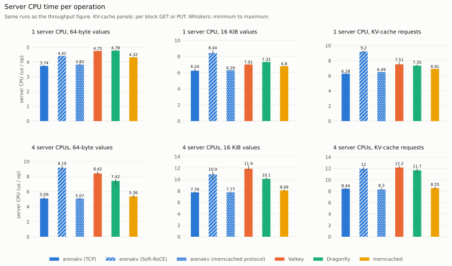
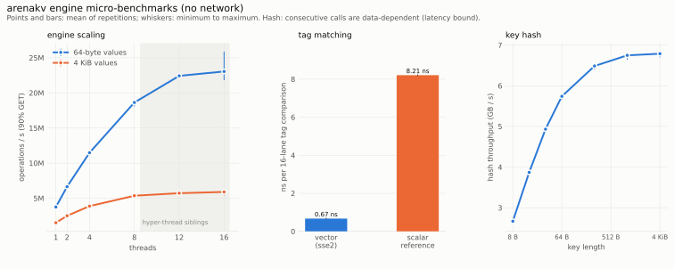

# arenakv

An in-memory key-value **cache** for large values. One server (`arenakvd`) serves the same engine over three
protocols: its native binary protocol over [`rdmaduct`](../rdmaduct) (RDMA or TCP), the **memcached** text and meta
protocol, and **RESP2** (the Redis protocol), so existing Redis and memcached clients work unchanged. The engine keeps
entries in log-structured memory, finds them through a growing hash index whose tags are compared with vector
instructions, and evicts with a second chance.

- Fixed memory budget; the oldest entries are evicted when it is full (or stores are refused with `--no-evict`).
  A lookup returns the most recent value stored for a key or reports a miss; it never returns an older version.
- Per-entry client flags, CAS versions and millisecond expiry; conditional stores (add, replace, append, prepend,
  CAS), increments, touch, flush, multi-key reads.
- Event-loop server: worker threads serve thousands of pipelined connections; native connections use rdmaduct's
  pollable descriptors.
- Authentication for all protocols, TLS for the text protocols (optional OpenSSL build), snapshots to disk with
  CRC-checked blocks, configuration file, log rotation, systemd unit and container image.
- Sharded engine: operations on different shards run in parallel. Tag comparison with SSE2 (x86-64) or NEON
  (aarch64), with a portable fallback.
- Client library (`akvclient.h`) with pipelining and consistent hashing over several servers, and a native driver
  for [`kvpace`](../kvpace).

**Status:** experimental, not for production use. No replication; strings only.

## Why this exists

Inference serving and HPC staging both keep values of kilobytes to megabytes. These values are written once,
read many times and evicted under memory pressure, often on clusters with RDMA networks. General-purpose caches
were designed for small objects over kernel TCP: they allocate per object, keep per-object metadata, and cannot
use an RDMA transport. `arenakv` is a cache built for that access pattern:

- **Log-structured arenas.** Entries are appended to a per-shard log, so storing a block costs no allocator call
  and fragmentation cannot build up. Same-size overwrites are done in place.
- **Vector-compared index.** A bucket's 16 tags are compared in one SSE2 or NEON instruction sequence, with a
  scalar fallback.
- **No stale reads.** A lookup returns the latest value stored for a key or a miss, never an older version. A
  model test against a reference map checks this under eviction.
- **Transport-independent server.** The native protocol runs over [`rdmaduct`](../rdmaduct), so the same binary
  serves TCP and RDMA clients, next to standard memcached and Redis clients on the text protocols.
- **Small enough to audit:** about 6,500 lines including the server, three protocols, persistence and the client.

memcached, Valkey and Dragonfly are mature and remain the right default for general caching. The measurements
below show where `arenakv` is in the same range, where it is better, and where it is worse.
[`../docs/PRIOR_ART.md`](../docs/PRIOR_ART.md) discusses when to choose which.

### Comparison

| | arenakv | memcached | Valkey / Redis | Dragonfly |
|---|---|---|---|---|
| Target values | large, mostly immutable blocks | small to medium objects | data structures | data structures |
| Memory layout | log-structured arena per shard | slab allocator | per-object allocation (jemalloc) | per-object allocation (mimalloc) |
| Eviction | second chance in write order | segmented LRU | approximate LRU / LFU policies | cache mode (2Q-based) |
| Network transport | TCP, TLS, RDMA reliable connections | TCP, UDP, Unix sockets, TLS | TCP, Unix sockets, TLS | TCP, TLS |
| Protocols | memcached text and meta, RESP2, native binary ([PROTOCOL.md](docs/PROTOCOL.md)) | text, meta, binary | RESP2, RESP3 | RESP2, RESP3, memcached text |
| Expiry, CAS, conditional stores, increments | yes | yes | yes | yes |
| Data types | strings | strings | strings, lists, hashes, sets, sorted sets, streams | as Valkey |
| Authentication | shared credentials file | SASL, ASCII auth | ACL users | ACL users |
| Persistence | snapshots (CRC-checked, atomic rename) | warm restart | RDB, AOF | snapshots |
| Replication, cluster | no (client-side consistent hashing) | no (client-side hashing) | yes | replication |
| Hash index | grows from a small size | grows | grows | grows |
| Production use | not recommended | widely deployed | widely deployed | deployed |

Statements about other systems reflect their public documentation at the time of writing.

### Measured results

Measured with this server version (event-loop workers, growing index, native and memcached protocols; the row
"memcached protocol" is arenakvd serving the memcached text protocol to the same kvpace driver as memcached). One machine with default configurations, server and load generator over loopback; "Soft-RoCE" is software RDMA.
Tables are generated from the raw data in [`../benchmarks/data`](../benchmarks/data). `make verify` at the repository
root checks them and every tagged statement. Method and caveats: [`../benchmarks/METHODOLOGY.md`](../benchmarks/METHODOLOGY.md).

<picture>
  <source media="(prefers-color-scheme: dark)" srcset="../benchmarks/figures/throughput-dark.svg">
  
</picture>

<!-- BEGIN GENERATED:matrix-throughput -->
Data: `benchmarks/data/2026-10-21-run2` (690 runs: 660 ok, 20 with operation errors, 0 failed, 10 skipped), commit `46efd6447c6d`, summary digest `95813d0d095ed976`. Mean over repetitions; `cv` is the coefficient of variation.

Operations per second (KV-cache rows: requests per second).

| Workload | Server CPUs | arenakv (TCP) | arenakv (Soft-RoCE) | arenakv (memcached protocol) | Valkey | Dragonfly | memcached |
|---|---|---|---|---|---|---|---|
| 64-byte values | 1 | 221,649 (cv 0.4%) | 203,726 (cv 0.8%) | 250,825 (cv 1.1%) | 207,438 (cv 0.5%) | 204,562 (cv 0.6%) | 226,135 (cv 0.7%) |
| 64-byte values | 4 | 731,229 (cv 0.6%) | 233,217 (cv 2.3%) | 849,389 (cv 0.8%) | 534,587 (cv 1.0%) | 567,459 (cv 1.4%) | 775,447 (cv 1.7%) |
| 16 KiB values | 1 | 143,866 (cv 1.1%) | 112,277 (cv 2.3%) | 154,248 (cv 2.0%) | 140,608 (cv 0.3%) | 134,652 (cv 0.8%) | 144,826 (cv 0.4%) |
| 16 KiB values | 4 | 511,973 (cv 1.3%) | 144,497 (cv 1.8%) | 558,377 (cv 1.9%) | 371,017 (cv 2.0%) | 415,075 (cv 2.3%) | 531,024 (cv 1.0%) |
| KV-cache requests | 1 | 1,839 (cv 0.6%) | 1,426 (cv 0.9%) | 1,932 (cv 1.0%) | 1,746 (cv 0.4%) | 1,773 (cv 0.5%) | 1,846 (cv 1.0%) |
| KV-cache requests | 4 | 4,800 (cv 1.2%) | 1,873 (cv 1.1%) | 5,227 (cv 1.4%) | 4,213 (cv 0.8%) | 2,809 (cv 11.9%) | 4,552 (cv 1.7%) |
<!-- END GENERATED:matrix-throughput -->

<picture>
  <source media="(prefers-color-scheme: dark)" srcset="../benchmarks/figures/cpu-per-op-dark.svg">
  
</picture>

<!-- BEGIN GENERATED:matrix-cpu -->
Data: `benchmarks/data/2026-10-21-run2` (690 runs: 660 ok, 20 with operation errors, 0 failed, 10 skipped), commit `46efd6447c6d`, summary digest `95813d0d095ed976`. Mean over repetitions; `cv` is the coefficient of variation.

Server CPU time per operation in microseconds (KV-cache rows: per block GET or PUT).

| Workload | Server CPUs | arenakv (TCP) | arenakv (Soft-RoCE) | arenakv (memcached protocol) | Valkey | Dragonfly | memcached |
|---|---|---|---|---|---|---|---|
| 64-byte values | 1 | 4.51 (cv 0.4%) | 4.91 (cv 0.8%) | 3.99 (cv 1.1%) | 4.82 (cv 0.5%) | 4.89 (cv 0.6%) | 4.42 (cv 0.7%) |
| 64-byte values | 4 | 5.31 (cv 0.7%) | 10.04 (cv 2.4%) | 4.69 (cv 0.7%) | 7.48 (cv 1.0%) | 6.91 (cv 1.4%) | 5.13 (cv 1.6%) |
| 16 KiB values | 1 | 6.95 (cv 1.1%) | 8.91 (cv 2.3%) | 6.48 (cv 2.1%) | 7.11 (cv 0.3%) | 7.42 (cv 0.9%) | 6.90 (cv 0.4%) |
| 16 KiB values | 4 | 7.75 (cv 1.2%) | 11.50 (cv 0.8%) | 7.09 (cv 1.9%) | 10.77 (cv 1.8%) | 9.39 (cv 2.0%) | 7.50 (cv 1.1%) |
| KV-cache requests | 1 | 7.10 (cv 0.6%) | 9.37 (cv 0.9%) | 6.71 (cv 1.1%) | 7.53 (cv 0.5%) | 7.40 (cv 0.6%) | 7.07 (cv 1.1%) |
| KV-cache requests | 4 | 8.37 (cv 1.4%) | 11.93 (cv 0.8%) | 7.87 (cv 1.9%) | 11.34 (cv 0.8%) | 11.74 (cv 5.6%) | 8.03 (cv 1.7%) |
<!-- END GENERATED:matrix-cpu -->

<picture>
  <source media="(prefers-color-scheme: dark)" srcset="../benchmarks/figures/capacity-dark.svg">
  
</picture>

<!-- BEGIN GENERATED:capacity-reuse -->
Data: `benchmarks/data/2026-10-21-run2` (690 runs: 660 ok, 20 with operation errors, 0 failed, 10 skipped), commit `46efd6447c6d`, summary digest `95813d0d095ed976`. Mean over repetitions; `cv` is the coefficient of variation.

KV-cache scenario, reuse rate (fraction of needed blocks served from the cache) by configured capacity.

| System | 16 MB | 64 MB | 256 MB | 1 GB | 4 GB |
|---|---|---|---|---|---|
| arenakv (TCP) | 0.186 (cv 1.2%) | 0.437 (cv 0.4%) | 0.652 (cv 0.4%) | 0.830 (cv 0.1%) | 0.903 (cv 0.0%) |
| Valkey | 0.036 (cv 4.6%) | 0.116 (cv 2.1%) | 0.308 (cv 0.7%) | 0.791 (cv 0.3%) | 0.902 (cv 0.0%) |
| Dragonfly | n/a | n/a | 0.411 (cv 1.3%) | 0.690 (cv 0.6%) | 0.902 (cv 0.0%) |
| Dragonfly (eviction flag raised) | n/a | n/a | 0.435 (cv 0.8%) | 0.604 (cv 0.7%) | 0.902 (cv 0.0%) |
| memcached | 0.354 (cv 0.8%) | 0.500 (cv 0.2%) | 0.665 (cv 0.2%) | 0.846 (cv 0.1%) | 0.903 (cv 0.0%) |
<!-- END GENERATED:capacity-reuse -->

<!-- BEGIN GENERATED:matrix-rss -->
Data: `benchmarks/data/2026-10-21-run2` (690 runs: 660 ok, 20 with operation errors, 0 failed, 10 skipped), commit `46efd6447c6d`, summary digest `95813d0d095ed976`. Mean over repetitions; `cv` is the coefficient of variation.

Server resident memory at the end of the run in MiB.

| Workload | Server CPUs | arenakv (TCP) | arenakv (Soft-RoCE) | arenakv (memcached protocol) | Valkey | Dragonfly | memcached |
|---|---|---|---|---|---|---|---|
| 64-byte values | 1 | 17 (cv 0.2%) | 50 (cv 0.1%) | 17 (cv 0.1%) | 23 (cv 0.1%) | 32 (cv 2.0%) | 21 (cv 0.2%) |
| 64-byte values | 4 | 17 (cv 0.1%) | 50 (cv 0.1%) | 17 (cv 0.2%) | 24 (cv 0.5%) | 35 (cv 2.1%) | 22 (cv 0.2%) |
| 16 KiB values | 1 | 318 (cv 0.0%) | 351 (cv 0.0%) | 318 (cv 0.0%) | 407 (cv 0.0%) | 339 (cv 0.2%) | 341 (cv 0.0%) |
| 16 KiB values | 4 | 318 (cv 0.0%) | 351 (cv 0.0%) | 318 (cv 0.0%) | 450 (cv 0.7%) | 345 (cv 0.2%) | 341 (cv 0.0%) |
| KV-cache requests | 1 | 2,687 (cv 0.5%) | 2,154 (cv 0.5%) | 2,821 (cv 1.1%) | 3,223 (cv 0.5%) | 2,653 (cv 0.6%) | 2,889 (cv 1.0%) |
| KV-cache requests | 4 | 7,148 (cv 0.7%) | 2,834 (cv 1.0%) | 7,801 (cv 1.0%) | 7,645 (cv 0.5%) | 4,945 (cv 4.8%) | 7,103 (cv 1.7%) |
<!-- END GENERATED:matrix-rss -->

<picture>
  <source media="(prefers-color-scheme: dark)" srcset="../benchmarks/figures/engine-dark.svg">
  
</picture>

<!-- BEGIN GENERATED:engine-scale -->
Data: `benchmarks/data/2026-10-21-run2` (690 runs: 660 ok, 20 with operation errors, 0 failed, 10 skipped), commit `46efd6447c6d`, summary digest `95813d0d095ed976`. Mean over repetitions; `cv` is the coefficient of variation.

Engine operations per second (90% GET, uniform keys, key space preloaded, no eviction).

| Value size | 1 threads | 2 threads | 4 threads | 8 threads | 12 threads | 16 threads |
|---|---|---|---|---|---|---|
| 64-byte values | 3,565,959 (cv 0.2%) | 6,043,200 (cv 1.1%) | 10,205,007 (cv 0.6%) | 16,650,776 (cv 0.8%) | 20,616,976 (cv 1.1%) | 22,854,775 (cv 2.2%) |
| 4096-byte values | 1,447,782 (cv 2.5%) | 2,441,348 (cv 1.4%) | 3,826,800 (cv 0.6%) | 5,343,564 (cv 0.4%) | 5,679,720 (cv 0.6%) | 5,898,117 (cv 1.7%) |
<!-- END GENERATED:engine-scale -->

<!-- BEGIN GENERATED:pipeline -->
Data: `benchmarks/data/2026-10-21-run2` (690 runs: 660 ok, 20 with operation errors, 0 failed, 10 skipped), commit `46efd6447c6d`, summary digest `95813d0d095ed976`. Mean over repetitions; `cv` is the coefficient of variation.

Closed loop, one server CPU, 64-byte values, 90% GET, 16 connections from 4 client threads, with the given number of requests in flight per connection. Latencies are GET latencies in microseconds.

| System | Depth | ops/s | p50 | p99 | Server CPU µs/op | Server RSS MiB |
|---|---|---|---|---|---|---|
| arenakv (TCP) | 1 | 242,165 (cv 0.3%) | 61 (cv 0.5%) | 126 (cv 0.3%) | 4.13 (cv 0.3%) | 17 (cv 0.2%) |
| arenakv (TCP) | 8 | 1,403,303 (cv 0.7%) | 84 (cv 0.8%) | 179 (cv 1.1%) | 0.71 (cv 0.8%) | 17 (cv 0.2%) |
| arenakv (TCP) | 32 | 2,211,746 (cv 2.2%) | 212 (cv 2.8%) | 468 (cv 3.4%) | 0.45 (cv 2.3%) | 19 (cv 0.1%) |
| arenakv (memcached protocol) | 1 | 283,322 (cv 0.3%) | 52 (cv 0.4%) | 109 (cv 0.4%) | 3.53 (cv 0.4%) | 17 (cv 0.2%) |
| arenakv (memcached protocol) | 8 | 1,550,965 (cv 1.7%) | 76 (cv 1.7%) | 164 (cv 2.4%) | 0.64 (cv 1.6%) | 17 (cv 0.1%) |
| arenakv (memcached protocol) | 32 | 3,288,067 (cv 1.5%) | 140 (cv 1.4%) | 313 (cv 2.7%) | 0.30 (cv 1.5%) | 17 (cv 0.1%) |
| Valkey | 1 | 216,647 (cv 0.3%) | 69 (cv 0.5%) | 137 (cv 0.4%) | 4.61 (cv 0.3%) | 23 (cv 0.2%) |
| Valkey | 8 | 1,148,165 (cv 0.1%) | 102 (cv 0.0%) | 172 (cv 1.3%) | 0.87 (cv 0.1%) | 23 (cv 0.5%) |
| Valkey | 32 | 2,221,454 (cv 0.3%) | 189 (cv 0.6%) | 353 (cv 0.5%) | 0.45 (cv 0.3%) | 23 (cv 0.5%) |
| Dragonfly | 1 | 211,326 (cv 0.5%) | 75 (cv 0.6%) | 96 (cv 1.4%) | 4.73 (cv 0.5%) | 32 (cv 2.6%) |
| Dragonfly | 8 | 803,231 (cv 0.4%) | 145 (cv 0.6%) | 254 (cv 0.5%) | 1.24 (cv 0.3%) | 33 (cv 2.0%) |
| Dragonfly | 32 | 1,265,653 (cv 1.4%) | 359 (cv 1.4%) | 690 (cv 1.9%) | 0.79 (cv 1.5%) | 33 (cv 2.0%) |
| memcached | 1 | 256,340 (cv 0.3%) | 56 (cv 0.2%) | 123 (cv 0.8%) | 3.90 (cv 0.3%) | 21 (cv 0.3%) |
| memcached | 8 | 1,180,820 (cv 1.3%) | 90 (cv 0.8%) | 290 (cv 1.9%) | 0.85 (cv 1.3%) | 21 (cv 0.5%) |
| memcached | 32 | 1,526,793 (cv 2.6%) | 295 (cv 2.5%) | 596 (cv 4.6%) | 0.66 (cv 2.7%) | 22 (cv 0.2%) |
<!-- END GENERATED:pipeline -->

Findings:

- Over the memcached protocol arenakv has the highest throughput in every matrix row [C1] and is faster than
  memcached at one server CPU in all three workloads [C3]. Over its native protocol it is faster than Valkey and
  Dragonfly at four server CPUs in all three workloads [C2] and uses less server CPU time per operation than both
  [C5].
- At pipeline depth 32 the memcached protocol leads all servers; the native protocol reaches the throughput of Valkey
  [C24].
- At small capacities arenakv reuses more cached blocks than Valkey [C11]; memcached is at least as good [C12].
- With 64-byte values arenakv has a lower resident memory than Valkey, Dragonfly and memcached [C16]: the hash index
  starts small and grows with the data. (The previous version sized it from the capacity and used more than eight
  times the memory of the others.)
- Under open-loop load arenakv sustains a higher rate than Valkey and Dragonfly and a lower one than memcached [C7].
- Over Soft-RoCE throughput is lower than over TCP in all six rows [C6]. Soft-RoCE is software; no RDMA hardware
  result exists.

## Requirements

Linux, a C compiler with `-std=gnu2x` (gcc 13 or newer, clang 18 or newer), `make`, pthreads, and `../rdmaduct`
(built automatically; `make RDMA=0` builds without the RDMA libraries). For RDMA: `libibverbs-dev`,
`librdmacm-dev` and an RDMA device (Soft-RoCE works for development).

## Build and test

```
make                  # build/<arch>/libarenakv.a, arenakvd, akv_bench
make TLS=1            # with TLS listeners (needs libssl-dev; build/<arch>-tls/)
make test             # engine, protocol, network and server tests
make RDMA=0 test      # without RDMA libraries (build/<arch>-tcp/)
make SAN=1 test       # AddressSanitizer + UndefinedBehaviorSanitizer
make TSAN=1 test      # ThreadSanitizer (the test binaries run with ASLR disabled)
make compat           # valkey-cli, valkey-benchmark, memtier_benchmark, redis-py against the server (Docker)
DUCT_TEST_ADDR=<rdma-interface-ip> make test    # also exercises the native protocol over RDMA
```

Test results: all suites pass on x86-64, including the RDMA cases over Soft-RoCE in both waiting modes, under
AddressSanitizer with UndefinedBehaviorSanitizer (also with TLS) and under ThreadSanitizer. `make compat` passes with
valkey-cli, valkey-benchmark, memtier_benchmark (RESP and memcached text) and redis-py. CI runs the TCP cases with gcc
and clang on x86-64 and arm64.

| Suite | Covers |
|---|---|
| `test_akv` | model check against a reference map (exact with ample memory, only the latest version under eviction) with a presized and a growing index; store modes, flags, CAS; expiry, touch, keep-ttl; increments; flush; enumeration; no-evict; eight-thread stress |
| `test_primitives` | vector tag matching equals the scalar reference for all lane combinations; hash avalanche and bucket distribution |
| `test_proto` | memcached and RESP commands with exact replies, also fed one byte at a time; framing errors; authentication; one million fuzzed inputs |
| `test_net` | pipelining, large values and backpressure on real sockets, 16 concurrent clients, connection limit, idle timeout, snapshots (round trip, corruption, truncation), TLS, native revision 2, consistent hashing |
| `test_server` | native protocol round trips, malformed requests, size limits, concurrent clients, shutdown with clients connected; over TCP, and over RDMA when `DUCT_TEST_ADDR` is set |

## Run the server

```
# drop-in cache for Redis and memcached clients
build/x86_64/arenakvd --port off --resp-port 6379 --memcached-port 11211 --capacity 8G

# native protocol over RDMA, persistence, authentication
build/x86_64/arenakvd --transport rdma --addr 192.0.2.10 --port 7600 --capacity 8G \
    --snapshot /var/lib/arenakv/arenakv.snap --save-interval 300 --auth-file /etc/arenakv/credentials

# everything from a file (contrib/arenakvd.conf)
build/x86_64/arenakvd --config /etc/arenakv/arenakvd.conf
```

```
$ valkey-cli -p 6379 SET block-17 payload EX 3600
OK
$ printf 'get block-17\r\n' | nc -q1 localhost 11211
VALUE block-17 0 7
payload
END
```

| Option | Default | Meaning |
|---|---|---|
| `--port PORT\|off`, `--addr`, `--transport tcp\|rdma\|auto`, `--wait poll\|event` | 7600, all, auto, event | native listener over rdmaduct |
| `--memcached-port`, `--resp-port`, `--text-addr` | off, off, all | text protocol listeners |
| `--tls-memcached-port`, `--tls-resp-port`, `--tls-cert`, `--tls-key`, `--tls-ca` | off | TLS listeners (TLS builds) |
| `--capacity SIZE` | 256M | cache memory (suffix K, M, G) |
| `--max-entry SIZE` | 1M | largest key + value |
| `--shards N` | 64 | engine shards, power of two |
| `--avg-entry BYTES` | 0 | presize the index for this mean entry size (0: grow on demand) |
| `--no-evict` | off | refuse stores when full instead of evicting |
| `--threads N` | CPUs of the affinity mask | worker threads |
| `--max-conns N`, `--idle-timeout SEC` | unlimited, never | connection limits |
| `--auth-file FILE` | none | credentials (`user:password` or a password per line) |
| `--snapshot FILE`, `--save-interval SEC`, `--no-save-on-stop` | none, off, save at stop | persistence |
| `--max-msg BYTES`, `--depth N` | 65536, 16 | native message size and buffers per connection |
| `--huge-pages` | off | advise transparent huge pages for the arenas |
| `--log-level`, `--log-file`, `--stats SEC` | info, stderr, off | logging (SIGHUP reopens the file) |
| `--config FILE` | none | read options from a file; the command line overrides it |

Operations guide (security, persistence, monitoring, deployment, compatibility notes):
[`docs/OPERATIONS.md`](docs/OPERATIONS.md).

## Use the client library

```c
#include "akvclient.h"

struct duct_opts opts;
duct_opts_default(&opts);
opts.transport = DUCT_TRANSPORT_TCP;      /* or DUCT_TRANSPORT_RDMA */
opts.max_msg = 64 * 1024;

akvc *c;
if (akvc_connect(&c, &opts, "192.0.2.10", "7600") != 0) { /* handle error */ }

struct akvp_ext x = {.ttl_ms = 3600 * 1000, .uflags = 7};
akvc_store(c, AKVP_ADD, "block-17", 8, data, data_len, &x, NULL);   /* AKVP_EXISTS when present */

size_t n;
int rc = akvc_get(c, "block-17", 8, buf, sizeof(buf), &n);
if (rc == AKVP_OK) { /* buf[0..n) holds the value */ }
else if (rc == AKVP_NOTFOUND) { /* miss or expired */ }

/* pipelining: post up to akvc_window(c) requests, then collect the responses in order; the posted
 * requests leave in one batch at the first akvc_next() (or akvc_push()) */
uint32_t id;
akvc_post(c, AKVP_GET, "a", 1, NULL, 0, NULL, &id);
akvc_post(c, AKVP_GET, "b", 1, NULL, 0, NULL, &id);
struct akvc_resp r;
akvc_next(c, &r, 1000);                   /* response to "a" */
akvc_next(c, &r, 1000);                   /* response to "b" */

akvc_close(c);
```

Several servers: `akvc_pool_create(&pool, &opts, servers, n)` and `akvc_pool_pick(pool, key, klen)` (consistent
hashing; removing a server moves only its keys). Return values are an `akvp_status` (0 or positive) when the server
answered and a negative `rdmaduct` error code when the transport failed. Link with `build/<arch>/libarenakv.a`,
`../rdmaduct/build/<arch>/librdmaduct.a`, `-lpthread` and, for RDMA builds, `-lrdmacm -libverbs`.

## Use the engine directly

`include/akv.h` is a self-contained in-process cache (`akv_create`, `akv_store`, `akv_get_meta`, `akv_incr`,
`akv_touch`, `akv_del`, `akv_flush`, `akv_foreach`, `akv_stats_get`); it has no dependency on the server or the
transport.

## Engine guarantees and limits

- Thread safety: all engine functions are thread-safe; an operation locks one shard.
- Keys: 1 to 65535 bytes. Entry (key + value): at most `max_entry` (default 1 MiB) and at most half of a shard arena.
- Memory: the arena is the configured capacity (divided over the shards); the hash index is additional and grows
  with the number of entries. Resident memory approaches the configured capacity once the log has wrapped.
- Expiry uses a monotonic clock; expired entries are never returned.
- Eviction order approximates least recently used: entries are removed in write order unless they were read.
- A store may fail with "too big" (or "no memory" with `--no-evict`); a read after a successful store may still
  miss because of eviction or expiry.

## Layout

| Path | Content |
|---|---|
| `include/` | public headers: `akv.h` (engine), `akvproto.h` (protocol), `akvd.h` (server), `akvclient.h` |
| `src/` | `akv.c` engine, `simd.h`, `hash.h`, `server.c` core, `proto_mc.c`, `proto_resp.c`, `snapshot.c`, `client.c` |
| `tools/` | `arenakvd` daemon, `akv_bench` micro-benchmarks |
| `tests/` | engine, protocol, network and server tests; `compat.sh` with third-party clients |
| `contrib/` | example configuration, systemd unit, Dockerfile |
| `docs/` | architecture, native protocol and operations |

## Further reading

[Architecture](docs/ARCHITECTURE.md) · [Protocol](docs/PROTOCOL.md) · [Operations](docs/OPERATIONS.md) ·
[Benchmarks](../benchmarks/README.md)
