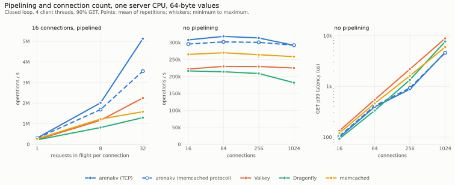

# Benchmarks

Measurements of `arenakv`, `kvpace` and `rdmaduct`, and of the established servers they are compared with, with
the raw data, the scripts that produced it, and checks that tie every published number and statement to that data.

| Item | Location |
|---|---|
| Raw results, environment and manifest of every run | [`data/`](data) |
| Figures (light and dark variants) | [`figures/`](figures) |
| Tables generated from the raw data | [`generated/`](generated) and the blocks below |
| Method, definitions, threats to validity | [`METHODOLOGY.md`](METHODOLOGY.md) |
| Orchestrator, report generator, verifier, claim definitions | [`tools/`](tools) |

The run described here is `data/<run>` where `<run>` is the name in [`LATEST`](LATEST).

## How to read this page

- Every figure has a table with the same data directly below it (the table view). Tables show the mean of the
  repetitions and, in parentheses, the coefficient of variation (`cv`).
- Figures show the mean with a whisker from the minimum to the maximum repetition.
- Statements such as "[C1]" are checked against the data by `tools/verify.py`; `tools/claims.py` contains the exact
  condition.
- All measurements come from **one machine** with **default configurations** and the **`powersave` CPU governor**.
  The server and the load generator share the machine and communicate over loopback. The RDMA rows use **Soft-RoCE**
  (software RDMA); they say nothing about RDMA hardware. Read [`METHODOLOGY.md`](METHODOLOGY.md#threats-to-validity)
  before drawing conclusions.

## Environment of the run

<!-- BEGIN GENERATED:environment -->
| Item | Value |
|---|---|
| Run | 2026-10-21-run2 |
| Date (UTC) | 2026-10-20T23:21:06Z |
| CPU | 12th Gen Intel(R) Core(TM) i9-12900K |
| Logical CPUs | 24 |
| CPU governor | powersave |
| Memory | 31.1 GiB |
| Kernel | 7.0.0-34-generic |
| OS | Ubuntu 24.04.5 LTS |
| Compiler | cc (Ubuntu 13.3.0-6ubuntu2~24.04.1) 13.3.0 |
| Network interface | enp4s0, 1000 Mbit/s |
| RDMA devices | link rxe0/1 state ACTIVE physical_state LINK_UP netdev enp4s0 |
| Valkey | Valkey server v=9.1.2 sha=00000000:0 malloc=jemalloc-5.3.0 bits=64 build=16129465b18d72a |
| Dragonfly | dragonfly v2.0.2-8ce4bbb106586057fbd85f71ed353c60d0d5bf87 |
| memcached | memcached 1.6.45 |
| Container runtime | Docker 29.9.0 |
| Source commit | 46efd6447c6d |
| Uncommitted files at run start | 0 |
<!-- END GENERATED:environment -->

Provenance of the run directory: every suite ran from the source commit above with a clean working tree, in the order
matrix, sweep, pipeline, connections, capacity, engine, transport, validation, then `capacity-evict` (Dragonfly with a
raised eviction flag) into the same directory with the same binaries. The server arguments are those of
`tools/run.py` and `kvpace/scripts/servers.sh` at that commit and are recorded in the manifest. The system ids
`kvstore`, `kvstore-rdma` and `kvstore-mc` in the raw data name arenakv over TCP, over Soft-RoCE and serving the
memcached text protocol. The previous run, `data/2026-10-20-run1`, measured the earlier server version (one thread
per connection, index sized from the capacity) and stays in the repository unchanged; the server CPU per KV-cache
operation is computed from its raw counters (see `tools/bench_data.py`).

## 1. Throughput of the servers

<picture>
  <source media="(prefers-color-scheme: dark)" srcset="figures/throughput-dark.svg">
  
</picture>

<!-- BEGIN GENERATED:matrix-throughput -->
Data: `benchmarks/data/2026-10-21-run2` (690 runs: 660 ok, 20 with operation errors, 0 failed, 10 skipped), commit `46efd6447c6d`, summary digest `95813d0d095ed976`. Mean over repetitions; `cv` is the coefficient of variation.

Operations per second (KV-cache rows: requests per second).

| Workload | Server CPUs | arenakv (TCP) | arenakv (Soft-RoCE) | arenakv (memcached protocol) | Valkey | Dragonfly | memcached |
|---|---|---|---|---|---|---|---|
| 64-byte values | 1 | 221,649 (cv 0.4%) | 203,726 (cv 0.8%) | 250,825 (cv 1.1%) | 207,438 (cv 0.5%) | 204,562 (cv 0.6%) | 226,135 (cv 0.7%) |
| 64-byte values | 4 | 731,229 (cv 0.6%) | 233,217 (cv 2.3%) | 849,389 (cv 0.8%) | 534,587 (cv 1.0%) | 567,459 (cv 1.4%) | 775,447 (cv 1.7%) |
| 16 KiB values | 1 | 143,866 (cv 1.1%) | 112,277 (cv 2.3%) | 154,248 (cv 2.0%) | 140,608 (cv 0.3%) | 134,652 (cv 0.8%) | 144,826 (cv 0.4%) |
| 16 KiB values | 4 | 511,973 (cv 1.3%) | 144,497 (cv 1.8%) | 558,377 (cv 1.9%) | 371,017 (cv 2.0%) | 415,075 (cv 2.3%) | 531,024 (cv 1.0%) |
| KV-cache requests | 1 | 1,839 (cv 0.6%) | 1,426 (cv 0.9%) | 1,932 (cv 1.0%) | 1,746 (cv 0.4%) | 1,773 (cv 0.5%) | 1,846 (cv 1.0%) |
| KV-cache requests | 4 | 4,800 (cv 1.2%) | 1,873 (cv 1.1%) | 5,227 (cv 1.4%) | 4,213 (cv 0.8%) | 2,809 (cv 11.9%) | 4,552 (cv 1.7%) |
<!-- END GENERATED:matrix-throughput -->

## 2. Server CPU per operation

<picture>
  <source media="(prefers-color-scheme: dark)" srcset="figures/cpu-per-op-dark.svg">
  
</picture>

<!-- BEGIN GENERATED:matrix-cpu -->
Data: `benchmarks/data/2026-10-21-run2` (690 runs: 660 ok, 20 with operation errors, 0 failed, 10 skipped), commit `46efd6447c6d`, summary digest `95813d0d095ed976`. Mean over repetitions; `cv` is the coefficient of variation.

Server CPU time per operation in microseconds (KV-cache rows: per block GET or PUT).

| Workload | Server CPUs | arenakv (TCP) | arenakv (Soft-RoCE) | arenakv (memcached protocol) | Valkey | Dragonfly | memcached |
|---|---|---|---|---|---|---|---|
| 64-byte values | 1 | 4.51 (cv 0.4%) | 4.91 (cv 0.8%) | 3.99 (cv 1.1%) | 4.82 (cv 0.5%) | 4.89 (cv 0.6%) | 4.42 (cv 0.7%) |
| 64-byte values | 4 | 5.31 (cv 0.7%) | 10.04 (cv 2.4%) | 4.69 (cv 0.7%) | 7.48 (cv 1.0%) | 6.91 (cv 1.4%) | 5.13 (cv 1.6%) |
| 16 KiB values | 1 | 6.95 (cv 1.1%) | 8.91 (cv 2.3%) | 6.48 (cv 2.1%) | 7.11 (cv 0.3%) | 7.42 (cv 0.9%) | 6.90 (cv 0.4%) |
| 16 KiB values | 4 | 7.75 (cv 1.2%) | 11.50 (cv 0.8%) | 7.09 (cv 1.9%) | 10.77 (cv 1.8%) | 9.39 (cv 2.0%) | 7.50 (cv 1.1%) |
| KV-cache requests | 1 | 7.10 (cv 0.6%) | 9.37 (cv 0.9%) | 6.71 (cv 1.1%) | 7.53 (cv 0.5%) | 7.40 (cv 0.6%) | 7.07 (cv 1.1%) |
| KV-cache requests | 4 | 8.37 (cv 1.4%) | 11.93 (cv 0.8%) | 7.87 (cv 1.9%) | 11.34 (cv 0.8%) | 11.74 (cv 5.6%) | 8.03 (cv 1.7%) |
<!-- END GENERATED:matrix-cpu -->

Latency in the closed loop (queueing at 16 connections, not latency at a given load):

<!-- BEGIN GENERATED:matrix-p99 -->
Data: `benchmarks/data/2026-10-21-run2` (690 runs: 660 ok, 20 with operation errors, 0 failed, 10 skipped), commit `46efd6447c6d`, summary digest `95813d0d095ed976`. Mean over repetitions; `cv` is the coefficient of variation.

GET latency p99 in microseconds in the closed loop (KV-cache rows: request latency).

| Workload | Server CPUs | arenakv (TCP) | arenakv (Soft-RoCE) | arenakv (memcached protocol) | Valkey | Dragonfly | memcached |
|---|---|---|---|---|---|---|---|
| 64-byte values | 1 | 141 (cv 0.4%) | 142 (cv 1.1%) | 125 (cv 0.8%) | 142 (cv 0.6%) | 99 (cv 1.8%) | 145 (cv 1.4%) |
| 64-byte values | 4 | 40 (cv 1.6%) | 321 (cv 10.2%) | 33 (cv 2.4%) | 62 (cv 16.9%) | 66 (cv 2.3%) | 41 (cv 14.7%) |
| 16 KiB values | 1 | 219 (cv 1.1%) | 321 (cv 14.7%) | 206 (cv 3.8%) | 157 (cv 0.9%) | 156 (cv 8.7%) | 228 (cv 0.5%) |
| 16 KiB values | 4 | 62 (cv 6.0%) | 585 (cv 1.6%) | 58 (cv 7.7%) | 96 (cv 21.5%) | 92 (cv 13.0%) | 84 (cv 11.9%) |
| KV-cache requests | 1 | 24,196 (cv 2.4%) | 25,192 (cv 2.1%) | 22,754 (cv 2.8%) | 19,399 (cv 0.5%) | 19,215 (cv 1.6%) | 24,091 (cv 2.5%) |
| KV-cache requests | 4 | 7,202 (cv 12.9%) | 22,492 (cv 4.8%) | 6,547 (cv 13.6%) | 8,415 (cv 5.6%) | 31,850 (cv 9.4%) | 8,375 (cv 11.0%) |
<!-- END GENERATED:matrix-p99 -->

Server resident memory at the end of each run:

<!-- BEGIN GENERATED:matrix-rss -->
Data: `benchmarks/data/2026-10-21-run2` (690 runs: 660 ok, 20 with operation errors, 0 failed, 10 skipped), commit `46efd6447c6d`, summary digest `95813d0d095ed976`. Mean over repetitions; `cv` is the coefficient of variation.

Server resident memory at the end of the run in MiB.

| Workload | Server CPUs | arenakv (TCP) | arenakv (Soft-RoCE) | arenakv (memcached protocol) | Valkey | Dragonfly | memcached |
|---|---|---|---|---|---|---|---|
| 64-byte values | 1 | 17 (cv 0.2%) | 50 (cv 0.1%) | 17 (cv 0.1%) | 23 (cv 0.1%) | 32 (cv 2.0%) | 21 (cv 0.2%) |
| 64-byte values | 4 | 17 (cv 0.1%) | 50 (cv 0.1%) | 17 (cv 0.2%) | 24 (cv 0.5%) | 35 (cv 2.1%) | 22 (cv 0.2%) |
| 16 KiB values | 1 | 318 (cv 0.0%) | 351 (cv 0.0%) | 318 (cv 0.0%) | 407 (cv 0.0%) | 339 (cv 0.2%) | 341 (cv 0.0%) |
| 16 KiB values | 4 | 318 (cv 0.0%) | 351 (cv 0.0%) | 318 (cv 0.0%) | 450 (cv 0.7%) | 345 (cv 0.2%) | 341 (cv 0.0%) |
| KV-cache requests | 1 | 2,687 (cv 0.5%) | 2,154 (cv 0.5%) | 2,821 (cv 1.1%) | 3,223 (cv 0.5%) | 2,653 (cv 0.6%) | 2,889 (cv 1.0%) |
| KV-cache requests | 4 | 7,148 (cv 0.7%) | 2,834 (cv 1.0%) | 7,801 (cv 1.0%) | 7,645 (cv 0.5%) | 4,945 (cv 4.8%) | 7,103 (cv 1.7%) |
<!-- END GENERATED:matrix-rss -->

## 3. Latency under offered load (open loop)

<picture>
  <source media="(prefers-color-scheme: dark)" srcset="figures/sweep-dark.svg">
  
</picture>

<!-- BEGIN GENERATED:sweep -->
Data: `benchmarks/data/2026-10-21-run2` (690 runs: 660 ok, 20 with operation errors, 0 failed, 10 skipped), commit `46efd6447c6d`, summary digest `95813d0d095ed976`. Mean over repetitions; `cv` is the coefficient of variation.

Open loop, one server CPU, 64-byte values, 16 connections. Latencies in microseconds, measured from the intended send time unless stated.

| System | Offered ops/s | Achieved ops/s | p50 | p99 | p99 service time | Max schedule lag (ms) |
|---|---|---|---|---|---|---|
| arenakv (TCP) | 20,000 | 20,000 (cv 0.0%) | 39 (cv 11.9%) | 789 (cv 60.2%) | 333 (cv 16.3%) | 7.0 (cv 68.4%) |
| arenakv (TCP) | 60,000 | 60,000 (cv 0.0%) | 83 (cv 29.0%) | 699 (cv 13.0%) | 530 (cv 6.1%) | 10.7 (cv 99.6%) |
| arenakv (TCP) | 100,000 | 99,999 (cv 0.0%) | 295 (cv 15.2%) | 5,702 (cv 27.9%) | 941 (cv 8.1%) | 39.5 (cv 57.7%) |
| arenakv (TCP) | 140,000 | 140,005 (cv 0.0%) | 239 (cv 10.8%) | 3,837 (cv 22.2%) | 664 (cv 3.5%) | 25.8 (cv 82.5%) |
| arenakv (TCP) | 180,000 | 179,999 (cv 0.0%) | 158 (cv 3.0%) | 3,097 (cv 46.5%) | 412 (cv 9.2%) | 24.1 (cv 83.2%) |
| arenakv (TCP) | 220,000 | 219,527 (cv 0.3%) | 157 (cv 19.3%) | 48,195 (cv 63.9%) | 140 (cv 1.1%) | 76.9 (cv 51.5%) |
| arenakv (TCP) | 260,000 | 219,283 (cv 1.3%) | 749,942 (cv 4.2%) | 1,489,817 (cv 4.8%) | 142 (cv 1.4%) | 1,656.2 (cv 4.5%) |
| Valkey | 20,000 | 20,000 (cv 0.0%) | 42 (cv 16.6%) | 517 (cv 52.1%) | 278 (cv 58.3%) | 3.6 (cv 10.7%) |
| Valkey | 60,000 | 60,000 (cv 0.0%) | 69 (cv 66.1%) | 881 (cv 20.2%) | 488 (cv 25.0%) | 22.0 (cv 73.5%) |
| Valkey | 100,000 | 99,999 (cv 0.0%) | 344 (cv 8.2%) | 6,167 (cv 11.8%) | 936 (cv 1.8%) | 31.0 (cv 80.4%) |
| Valkey | 140,000 | 139,997 (cv 0.0%) | 171 (cv 6.7%) | 3,328 (cv 52.6%) | 546 (cv 4.3%) | 43.5 (cv 94.6%) |
| Valkey | 180,000 | 180,003 (cv 0.0%) | 95 (cv 2.0%) | 18,785 (cv 88.9%) | 283 (cv 2.7%) | 56.3 (cv 80.6%) |
| Valkey | 220,000 | 205,279 (cv 1.3%) | 330,511 (cv 14.1%) | 552,390 (cv 16.5%) | 143 (cv 0.9%) | 574.3 (cv 15.7%) |
| Valkey | 260,000 | 206,645 (cv 0.8%) | 1,020,055 (cv 3.1%) | 1,640,812 (cv 3.2%) | 143 (cv 1.1%) | 1,677.0 (cv 3.1%) |
| Dragonfly | 20,000 | 20,000 (cv 0.0%) | 31 (cv 1.0%) | 400 (cv 43.3%) | 257 (cv 52.3%) | 5.0 (cv 43.2%) |
| Dragonfly | 60,000 | 60,001 (cv 0.0%) | 91 (cv 42.9%) | 930 (cv 16.0%) | 585 (cv 7.5%) | 23.7 (cv 52.6%) |
| Dragonfly | 100,000 | 99,995 (cv 0.0%) | 440 (cv 13.9%) | 6,724 (cv 12.8%) | 798 (cv 7.5%) | 20.8 (cv 48.6%) |
| Dragonfly | 140,000 | 140,006 (cv 0.0%) | 252 (cv 7.8%) | 3,890 (cv 8.4%) | 484 (cv 8.4%) | 19.5 (cv 50.4%) |
| Dragonfly | 180,000 | 179,996 (cv 0.0%) | 133 (cv 5.5%) | 40,351 (cv 85.8%) | 203 (cv 15.4%) | 72.2 (cv 81.8%) |
| Dragonfly | 220,000 | 204,589 (cv 0.6%) | 342,255 (cv 6.0%) | 577,136 (cv 6.2%) | 101 (cv 1.8%) | 592.2 (cv 5.6%) |
| Dragonfly | 260,000 | 203,236 (cv 1.2%) | 1,082,130 (cv 3.9%) | 1,791,807 (cv 6.8%) | 103 (cv 6.1%) | 1,840.5 (cv 7.4%) |
| memcached | 20,000 | 20,000 (cv 0.0%) | 37 (cv 5.0%) | 348 (cv 39.1%) | 260 (cv 50.2%) | 3.4 (cv 10.5%) |
| memcached | 60,000 | 59,999 (cv 0.0%) | 69 (cv 53.5%) | 592 (cv 26.2%) | 458 (cv 29.2%) | 9.3 (cv 90.5%) |
| memcached | 100,000 | 99,995 (cv 0.0%) | 388 (cv 8.9%) | 6,495 (cv 11.0%) | 1,034 (cv 2.5%) | 32.8 (cv 108.2%) |
| memcached | 140,000 | 139,999 (cv 0.0%) | 256 (cv 5.5%) | 3,598 (cv 11.8%) | 694 (cv 2.2%) | 29.7 (cv 73.1%) |
| memcached | 180,000 | 180,117 (cv 0.1%) | 167 (cv 5.7%) | 9,585 (cv 158.3%) | 432 (cv 5.8%) | 50.7 (cv 112.4%) |
| memcached | 220,000 | 220,002 (cv 0.0%) | 104 (cv 3.9%) | 18,221 (cv 104.6%) | 195 (cv 6.2%) | 43.0 (cv 59.6%) |
| memcached | 260,000 | 226,847 (cv 0.5%) | 607,335 (cv 7.4%) | 1,231,448 (cv 4.0%) | 142 (cv 1.6%) | 1,366.7 (cv 4.4%) |
<!-- END GENERATED:sweep -->

Why latency is measured from the intended send time:

<picture>
  <source media="(prefers-color-scheme: dark)" srcset="figures/coordinated-omission-dark.svg">
  
</picture>

## 4. Pipelining and connection count

Closed loop, one server CPU, 64-byte values, 90% GET, 4 client threads. Left: 16 connections with 1, 8 or 32
requests in flight each. Middle and right: 16 to 1024 connections, one request in flight each.

<picture>
  <source media="(prefers-color-scheme: dark)" srcset="figures/concurrency-dark.svg">
  
</picture>

<!-- BEGIN GENERATED:pipeline -->
Data: `benchmarks/data/2026-10-21-run2` (690 runs: 660 ok, 20 with operation errors, 0 failed, 10 skipped), commit `46efd6447c6d`, summary digest `95813d0d095ed976`. Mean over repetitions; `cv` is the coefficient of variation.

Closed loop, one server CPU, 64-byte values, 90% GET, 16 connections from 4 client threads, with the given number of requests in flight per connection. Latencies are GET latencies in microseconds.

| System | Depth | ops/s | p50 | p99 | Server CPU µs/op | Server RSS MiB |
|---|---|---|---|---|---|---|
| arenakv (TCP) | 1 | 242,165 (cv 0.3%) | 61 (cv 0.5%) | 126 (cv 0.3%) | 4.13 (cv 0.3%) | 17 (cv 0.2%) |
| arenakv (TCP) | 8 | 1,403,303 (cv 0.7%) | 84 (cv 0.8%) | 179 (cv 1.1%) | 0.71 (cv 0.8%) | 17 (cv 0.2%) |
| arenakv (TCP) | 32 | 2,211,746 (cv 2.2%) | 212 (cv 2.8%) | 468 (cv 3.4%) | 0.45 (cv 2.3%) | 19 (cv 0.1%) |
| arenakv (memcached protocol) | 1 | 283,322 (cv 0.3%) | 52 (cv 0.4%) | 109 (cv 0.4%) | 3.53 (cv 0.4%) | 17 (cv 0.2%) |
| arenakv (memcached protocol) | 8 | 1,550,965 (cv 1.7%) | 76 (cv 1.7%) | 164 (cv 2.4%) | 0.64 (cv 1.6%) | 17 (cv 0.1%) |
| arenakv (memcached protocol) | 32 | 3,288,067 (cv 1.5%) | 140 (cv 1.4%) | 313 (cv 2.7%) | 0.30 (cv 1.5%) | 17 (cv 0.1%) |
| Valkey | 1 | 216,647 (cv 0.3%) | 69 (cv 0.5%) | 137 (cv 0.4%) | 4.61 (cv 0.3%) | 23 (cv 0.2%) |
| Valkey | 8 | 1,148,165 (cv 0.1%) | 102 (cv 0.0%) | 172 (cv 1.3%) | 0.87 (cv 0.1%) | 23 (cv 0.5%) |
| Valkey | 32 | 2,221,454 (cv 0.3%) | 189 (cv 0.6%) | 353 (cv 0.5%) | 0.45 (cv 0.3%) | 23 (cv 0.5%) |
| Dragonfly | 1 | 211,326 (cv 0.5%) | 75 (cv 0.6%) | 96 (cv 1.4%) | 4.73 (cv 0.5%) | 32 (cv 2.6%) |
| Dragonfly | 8 | 803,231 (cv 0.4%) | 145 (cv 0.6%) | 254 (cv 0.5%) | 1.24 (cv 0.3%) | 33 (cv 2.0%) |
| Dragonfly | 32 | 1,265,653 (cv 1.4%) | 359 (cv 1.4%) | 690 (cv 1.9%) | 0.79 (cv 1.5%) | 33 (cv 2.0%) |
| memcached | 1 | 256,340 (cv 0.3%) | 56 (cv 0.2%) | 123 (cv 0.8%) | 3.90 (cv 0.3%) | 21 (cv 0.3%) |
| memcached | 8 | 1,180,820 (cv 1.3%) | 90 (cv 0.8%) | 290 (cv 1.9%) | 0.85 (cv 1.3%) | 21 (cv 0.5%) |
| memcached | 32 | 1,526,793 (cv 2.6%) | 295 (cv 2.5%) | 596 (cv 4.6%) | 0.66 (cv 2.7%) | 22 (cv 0.2%) |
<!-- END GENERATED:pipeline -->

<!-- BEGIN GENERATED:connections -->
Data: `benchmarks/data/2026-10-21-run2` (690 runs: 660 ok, 20 with operation errors, 0 failed, 10 skipped), commit `46efd6447c6d`, summary digest `95813d0d095ed976`. Mean over repetitions; `cv` is the coefficient of variation.

Closed loop, one server CPU, 64-byte values, 90% GET, connections spread over 4 client threads, one request in flight per connection. Latencies are GET latencies in microseconds.

| System | Connections | ops/s | p50 | p99 | Server CPU µs/op | Server RSS MiB |
|---|---|---|---|---|---|---|
| arenakv (TCP) | 16 | 242,278 (cv 0.6%) | 61 (cv 0.7%) | 126 (cv 0.6%) | 4.13 (cv 0.6%) | 17 (cv 0.1%) |
| arenakv (TCP) | 64 | 247,043 (cv 0.3%) | 251 (cv 0.3%) | 505 (cv 0.5%) | 4.05 (cv 0.2%) | 17 (cv 0.1%) |
| arenakv (TCP) | 256 | 243,538 (cv 0.3%) | 1,045 (cv 0.3%) | 1,116 (cv 0.8%) | 4.10 (cv 0.4%) | 19 (cv 0.2%) |
| arenakv (TCP) | 1,024 | 218,642 (cv 1.1%) | 4,535 (cv 0.6%) | 6,567 (cv 4.4%) | 4.58 (cv 1.1%) | 27 (cv 0.1%) |
| arenakv (memcached protocol) | 16 | 283,635 (cv 0.5%) | 52 (cv 0.6%) | 109 (cv 0.5%) | 3.53 (cv 0.7%) | 17 (cv 0.2%) |
| arenakv (memcached protocol) | 64 | 292,220 (cv 0.3%) | 210 (cv 0.3%) | 427 (cv 0.3%) | 3.42 (cv 0.3%) | 17 (cv 0.2%) |
| arenakv (memcached protocol) | 256 | 288,338 (cv 0.4%) | 882 (cv 0.5%) | 954 (cv 0.7%) | 3.47 (cv 0.3%) | 19 (cv 0.2%) |
| arenakv (memcached protocol) | 1,024 | 279,751 (cv 1.6%) | 3,601 (cv 1.6%) | 4,705 (cv 5.0%) | 3.58 (cv 1.7%) | 25 (cv 0.1%) |
| Valkey | 16 | 216,696 (cv 0.4%) | 69 (cv 0.3%) | 136 (cv 0.3%) | 4.61 (cv 0.4%) | 23 (cv 0.6%) |
| Valkey | 64 | 224,979 (cv 0.3%) | 274 (cv 0.3%) | 557 (cv 0.0%) | 4.44 (cv 0.3%) | 23 (cv 0.4%) |
| Valkey | 256 | 223,081 (cv 0.7%) | 1,116 (cv 0.6%) | 2,251 (cv 0.8%) | 4.48 (cv 0.7%) | 24 (cv 0.5%) |
| Valkey | 1,024 | 216,391 (cv 1.3%) | 4,542 (cv 1.3%) | 9,136 (cv 1.4%) | 4.62 (cv 1.3%) | 28 (cv 2.3%) |
| Dragonfly | 16 | 211,773 (cv 0.2%) | 75 (cv 0.3%) | 96 (cv 3.9%) | 4.72 (cv 0.2%) | 32 (cv 2.5%) |
| Dragonfly | 64 | 208,327 (cv 0.5%) | 306 (cv 0.6%) | 348 (cv 2.0%) | 4.80 (cv 0.5%) | 34 (cv 1.9%) |
| Dragonfly | 256 | 203,098 (cv 1.0%) | 1,262 (cv 1.1%) | 1,388 (cv 1.5%) | 4.92 (cv 1.0%) | 42 (cv 1.5%) |
| Dragonfly | 1,024 | 176,621 (cv 2.2%) | 5,662 (cv 2.7%) | 7,956 (cv 5.0%) | 5.66 (cv 2.3%) | 75 (cv 0.9%) |
| memcached | 16 | 257,889 (cv 0.3%) | 56 (cv 0.6%) | 123 (cv 0.7%) | 3.88 (cv 0.3%) | 21 (cv 0.2%) |
| memcached | 64 | 262,049 (cv 1.0%) | 232 (cv 1.2%) | 475 (cv 1.1%) | 3.81 (cv 1.0%) | 21 (cv 0.2%) |
| memcached | 256 | 256,433 (cv 1.1%) | 981 (cv 1.0%) | 1,843 (cv 8.2%) | 3.90 (cv 1.1%) | 22 (cv 0.2%) |
| memcached | 1,024 | 248,839 (cv 0.7%) | 4,027 (cv 0.4%) | 5,806 (cv 4.5%) | 4.02 (cv 0.8%) | 22 (cv 0.5%) |
<!-- END GENERATED:connections -->

## 5. KV-cache workload: reuse versus capacity

<picture>
  <source media="(prefers-color-scheme: dark)" srcset="figures/capacity-dark.svg">
  
</picture>

<!-- BEGIN GENERATED:capacity-reuse -->
Data: `benchmarks/data/2026-10-21-run2` (690 runs: 660 ok, 20 with operation errors, 0 failed, 10 skipped), commit `46efd6447c6d`, summary digest `95813d0d095ed976`. Mean over repetitions; `cv` is the coefficient of variation.

KV-cache scenario, reuse rate (fraction of needed blocks served from the cache) by configured capacity.

| System | 16 MB | 64 MB | 256 MB | 1 GB | 4 GB |
|---|---|---|---|---|---|
| arenakv (TCP) | 0.186 (cv 1.2%) | 0.437 (cv 0.4%) | 0.652 (cv 0.4%) | 0.830 (cv 0.1%) | 0.903 (cv 0.0%) |
| Valkey | 0.036 (cv 4.6%) | 0.116 (cv 2.1%) | 0.308 (cv 0.7%) | 0.791 (cv 0.3%) | 0.902 (cv 0.0%) |
| Dragonfly | n/a | n/a | 0.411 (cv 1.3%) | 0.690 (cv 0.6%) | 0.902 (cv 0.0%) |
| Dragonfly (eviction flag raised) | n/a | n/a | 0.435 (cv 0.8%) | 0.604 (cv 0.7%) | 0.902 (cv 0.0%) |
| memcached | 0.354 (cv 0.8%) | 0.500 (cv 0.2%) | 0.665 (cv 0.2%) | 0.846 (cv 0.1%) | 0.903 (cv 0.0%) |
<!-- END GENERATED:capacity-reuse -->

<!-- BEGIN GENERATED:capacity-throughput -->
Data: `benchmarks/data/2026-10-21-run2` (690 runs: 660 ok, 20 with operation errors, 0 failed, 10 skipped), commit `46efd6447c6d`, summary digest `95813d0d095ed976`. Mean over repetitions; `cv` is the coefficient of variation.

KV-cache scenario, requests per second by configured capacity.

| System | 16 MB | 64 MB | 256 MB | 1 GB | 4 GB |
|---|---|---|---|---|---|
| arenakv (TCP) | 2,020 (cv 0.7%) | 1,787 (cv 0.8%) | 1,755 (cv 1.1%) | 1,760 (cv 0.1%) | 1,737 (cv 0.6%) |
| Valkey | 1,930 (cv 0.3%) | 1,805 (cv 0.4%) | 1,734 (cv 0.3%) | 1,660 (cv 0.8%) | 1,609 (cv 0.2%) |
| Dragonfly | n/a | n/a | 174 (cv 1.3%) | 529 (cv 1.6%) | 1,598 (cv 0.4%) |
| Dragonfly (eviction flag raised) | n/a | n/a | 1,630 (cv 0.2%) | 1,617 (cv 1.0%) | 1,517 (cv 2.2%) |
| memcached | 1,998 (cv 0.5%) | 1,864 (cv 1.1%) | 1,847 (cv 1.5%) | 1,837 (cv 1.4%) | 1,753 (cv 0.2%) |
<!-- END GENERATED:capacity-throughput -->

Share of requests that failed because the server rejected an operation:

<!-- BEGIN GENERATED:capacity-errors -->
Data: `benchmarks/data/2026-10-21-run2` (690 runs: 660 ok, 20 with operation errors, 0 failed, 10 skipped), commit `46efd6447c6d`, summary digest `95813d0d095ed976`. Mean over repetitions; `cv` is the coefficient of variation.

Share of KV-cache requests that failed (an operation was rejected by the server, for example with an out-of-memory error), by configured capacity.

| System | 16 MB | 64 MB | 256 MB | 1 GB | 4 GB |
|---|---|---|---|---|---|
| arenakv (TCP) | 0.00% | 0.00% | 0.00% | 0.00% | 0.00% |
| Valkey | 0.00% | 0.00% | 0.00% | 0.00% | 0.00% |
| Dragonfly | n/a | n/a | 96.13% | 84.71% | 0.00% |
| Dragonfly (eviction flag raised) | n/a | n/a | 0.00% | 0.00% | 0.00% |
| memcached | 0.02% | 0.00% | 0.00% | 0.00% | 0.00% |
<!-- END GENERATED:capacity-errors -->

<!-- BEGIN GENERATED:capacity-skipped -->
Skipped configurations: dragonfly at 16mb (dragonfly refuses to start with less than 256 MiB per thread); dragonfly at 64mb (dragonfly refuses to start with less than 256 MiB per thread).
<!-- END GENERATED:capacity-skipped -->

## 6. arenakv engine

<picture>
  <source media="(prefers-color-scheme: dark)" srcset="figures/engine-dark.svg">
  
</picture>

<!-- BEGIN GENERATED:engine-scale -->
Data: `benchmarks/data/2026-10-21-run2` (690 runs: 660 ok, 20 with operation errors, 0 failed, 10 skipped), commit `46efd6447c6d`, summary digest `95813d0d095ed976`. Mean over repetitions; `cv` is the coefficient of variation.

Engine operations per second (90% GET, uniform keys, key space preloaded, no eviction).

| Value size | 1 threads | 2 threads | 4 threads | 8 threads | 12 threads | 16 threads |
|---|---|---|---|---|---|---|
| 64-byte values | 3,565,959 (cv 0.2%) | 6,043,200 (cv 1.1%) | 10,205,007 (cv 0.6%) | 16,650,776 (cv 0.8%) | 20,616,976 (cv 1.1%) | 22,854,775 (cv 2.2%) |
| 4096-byte values | 1,447,782 (cv 2.5%) | 2,441,348 (cv 1.4%) | 3,826,800 (cv 0.6%) | 5,343,564 (cv 0.4%) | 5,679,720 (cv 0.6%) | 5,898,117 (cv 1.7%) |
<!-- END GENERATED:engine-scale -->

<!-- BEGIN GENERATED:engine-micro -->
Data: `benchmarks/data/2026-10-21-run2` (690 runs: 660 ok, 20 with operation errors, 0 failed, 10 skipped), commit `46efd6447c6d`, summary digest `95813d0d095ed976`. Mean over repetitions; `cv` is the coefficient of variation.

| Measurement | Result |
|---|---|
| 16-lane tag comparison, vector (sse2) | 0.730 ns (cv 6.5%) |
| 16-lane tag comparison, scalar reference | 8.479 ns (cv 3.6%) |
| Speedup of the vector version | 11.6x (cv 4.6%) |
| Key hash, 8-byte key | 3.03 ns (cv 2.1%) |
| Key hash, 16-byte key | 4.14 ns (cv 2.2%) |
| Key hash, 32-byte key | 6.53 ns (cv 2.6%) |
| Key hash, 64-byte key | 11.22 ns (cv 1.3%) |
| Key hash, 256-byte key | 39.71 ns (cv 2.3%) |
| Key hash, 1024-byte key | 153.29 ns (cv 1.4%) |
| Key hash, 4096-byte key | 610.37 ns (cv 2.2%) |
<!-- END GENERATED:engine-micro -->

## 7. rdmaduct transport (loopback on one host)

<picture>
  <source media="(prefers-color-scheme: dark)" srcset="figures/transport-dark.svg">
  
</picture>

<!-- BEGIN GENERATED:transport-rtt -->
Data: `benchmarks/data/2026-10-21-run2` (690 runs: 660 ok, 20 with operation errors, 0 failed, 10 skipped), commit `46efd6447c6d`, summary digest `95813d0d095ed976`. Mean over repetitions; `cv` is the coefficient of variation.

Median round-trip time in microseconds (ping-pong, one message in flight). Loopback on one host.

| Message bytes | TCP | Soft-RoCE, polling | Soft-RoCE, event-driven |
|---|---|---|---|
| 64 | 9.6 (cv 37.9%) | 6.8 (cv 2.7%) | 10.3 (cv 9.7%) |
| 256 | 7.8 (cv 0.4%) | 6.7 (cv 3.4%) | 10.1 (cv 1.8%) |
| 1024 | 8.1 (cv 2.0%) | 7.2 (cv 2.9%) | 10.7 (cv 3.6%) |
| 4096 | 9.0 (cv 2.5%) | 11.2 (cv 1.8%) | 15.1 (cv 1.7%) |
| 16384 | 16.2 (cv 45.4%) | 30.4 (cv 1.4%) | 35.3 (cv 2.0%) |
| 65536 | 29.2 (cv 35.9%) | 106.5 (cv 0.9%) | 113.4 (cv 1.8%) |
| 262144 | 50.6 (cv 2.3%) | 442.1 (cv 2.7%) | 459.6 (cv 1.9%) |
| 1048576 | 185.7 (cv 1.7%) | 1,898.3 (cv 1.3%) | 1,938.9 (cv 1.1%) |
<!-- END GENERATED:transport-rtt -->

<!-- BEGIN GENERATED:transport-rtt-p99 -->
Data: `benchmarks/data/2026-10-21-run2` (690 runs: 660 ok, 20 with operation errors, 0 failed, 10 skipped), commit `46efd6447c6d`, summary digest `95813d0d095ed976`. Mean over repetitions; `cv` is the coefficient of variation.

p99 round-trip time in microseconds. Loopback on one host.

| Message bytes | TCP | Soft-RoCE, polling | Soft-RoCE, event-driven |
|---|---|---|---|
| 64 | 22.5 (cv 39.0%) | 9.3 (cv 9.8%) | 13.1 (cv 10.4%) |
| 256 | 9.3 (cv 2.2%) | 8.5 (cv 4.8%) | 12.6 (cv 7.5%) |
| 1024 | 11.6 (cv 34.8%) | 8.7 (cv 5.7%) | 13.6 (cv 12.3%) |
| 4096 | 12.8 (cv 38.5%) | 13.7 (cv 6.3%) | 18.8 (cv 3.9%) |
| 16384 | 39.3 (cv 81.1%) | 37.1 (cv 9.2%) | 46.5 (cv 5.2%) |
| 65536 | 64.1 (cv 55.9%) | 124.6 (cv 6.9%) | 146.5 (cv 11.8%) |
| 262144 | 80.9 (cv 29.9%) | 485.3 (cv 2.0%) | 664.7 (cv 5.9%) |
| 1048576 | 259.1 (cv 49.5%) | 2,215.1 (cv 14.1%) | 2,649.9 (cv 10.7%) |
<!-- END GENERATED:transport-rtt-p99 -->

<!-- BEGIN GENERATED:transport-stream -->
Data: `benchmarks/data/2026-10-21-run2` (690 runs: 660 ok, 20 with operation errors, 0 failed, 10 skipped), commit `46efd6447c6d`, summary digest `95813d0d095ed976`. Mean over repetitions; `cv` is the coefficient of variation.

One-way streaming throughput in MB/s (batched sends, 64 buffers per direction). Loopback on one host.

| Message bytes | TCP | Soft-RoCE, polling | Soft-RoCE, event-driven |
|---|---|---|---|
| 64 | 285 (cv 26.5%) | 46 (cv 6.8%) | 47 (cv 2.6%) |
| 256 | 1,037 (cv 1.4%) | 188 (cv 2.7%) | 178 (cv 6.6%) |
| 1024 | 3,287 (cv 12.7%) | 730 (cv 2.2%) | 715 (cv 2.2%) |
| 4096 | 7,352 (cv 20.5%) | 915 (cv 0.5%) | 968 (cv 1.6%) |
| 16384 | 10,546 (cv 9.1%) | 1,155 (cv 1.3%) | 1,137 (cv 0.9%) |
| 65536 | 9,213 (cv 20.7%) | 1,279 (cv 3.0%) | 1,263 (cv 1.9%) |
| 262144 | 5,757 (cv 10.3%) | 1,170 (cv 4.4%) | 1,158 (cv 1.9%) |
| 1048576 | 6,329 (cv 43.2%) | 1,124 (cv 2.5%) | 1,087 (cv 2.4%) |
<!-- END GENERATED:transport-stream -->

## 8. Validation of the load generator

`kvpace` against `memtier_benchmark` on the same server and settings (see
[`../kvpace/docs/validation.md`](../kvpace/docs/validation.md)):

<!-- BEGIN GENERATED:validation -->
Data: `benchmarks/data/2026-10-21-run2` (690 runs: 660 ok, 20 with operation errors, 0 failed, 10 skipped), commit `46efd6447c6d`, summary digest `95813d0d095ed976`. Mean over repetitions; `cv` is the coefficient of variation.

One server CPU, 64-byte values, 90% GET. memtier_benchmark runs `-t 1 -c 1` for one connection and `-t 4 -c 4` for 16. Latencies are GET latencies in microseconds; memtier reports milliseconds with three decimals.

| Server | Connections | kvpace client model | kvpace ops/s | memtier ops/s | Ratio | kvpace p50 | memtier p50 | kvpace p99 | memtier p99 |
|---|---|---|---|---|---|---|---|---|---|
| Valkey (RESP) | 1 | 1 thread, 1 connection | 110,854 (cv 4.2%) | 87,675 (cv 1.1%) | 1.26 | 8.7 (cv 1.6%) | 15.0 (cv 0.0%) | 12 (cv 10.0%) | 15 (cv 0.0%) |
| Valkey (RESP) | 16 | 4 threads x 4 connections | 216,870 (cv 0.2%) | 222,912 (cv 0.3%) | 0.97 | 68.6 (cv 0.0%) | 71.0 (cv 0.0%) | 137 (cv 0.4%) | 100 (cv 4.4%) |
| Valkey (RESP) | 16 | 16 threads x 1 connection | 207,490 (cv 0.4%) | 222,912 (cv 0.3%) | 0.93 | 74.0 (cv 0.6%) | 71.0 (cv 0.0%) | 142 (cv 0.6%) | 100 (cv 4.4%) |
| arenakv (memcached protocol) | 1 | 1 thread, 1 connection | 132,154 (cv 1.0%) | 99,894 (cv 0.6%) | 1.32 | 7.4 (cv 0.9%) | 15.0 (cv 0.0%) | 10 (cv 3.0%) | 15 (cv 0.0%) |
| arenakv (memcached protocol) | 16 | 4 threads x 4 connections | 284,160 (cv 0.4%) | 285,290 (cv 0.4%) | 1.00 | 51.6 (cv 0.4%) | 55.0 (cv 0.0%) | 109 (cv 0.3%) | 111 (cv 0.0%) |
| arenakv (memcached protocol) | 16 | 16 threads x 1 connection | 252,072 (cv 0.3%) | 285,290 (cv 0.4%) | 0.88 | 59.2 (cv 0.4%) | 55.0 (cv 0.0%) | 124 (cv 0.4%) | 111 (cv 0.0%) |
<!-- END GENERATED:validation -->

## Findings

Each statement below is checked against the data (tag `[C<n>]`, definition in [`tools/claims.py`](tools/claims.py)).
Differences are stated only for means or, where noted, for non-overlapping repetition ranges.

**Closed-loop throughput and server CPU (loopback, TCP)**

- arenakv over the memcached protocol has the highest mean throughput in all six rows of the matrix [C1]. At one
  server CPU it is faster than memcached in all three workloads, with non-overlapping ranges [C3]; both serve the
  same protocol to the same client, so the difference is the server.
- At four server CPUs the throughput of arenakv over its native protocol is higher than that of Valkey and of
  Dragonfly in all three workloads, with non-overlapping ranges [C2]. The four-CPU rows may be limited by the load
  generator (see [`METHODOLOGY.md`](METHODOLOGY.md#threats-to-validity)), so they show the order of the systems
  under this client, not server capacity.
- arenakv over the memcached protocol has the lowest mean server CPU time per operation of the five TCP servers in all
  six rows [C4]. At four server CPUs arenakv over its native protocol uses less server CPU time per operation than
  Valkey and Dragonfly in all three workloads [C5]. The native protocol costs more server CPU than the memcached
  protocol on the same server, because every native message passes through rdmaduct's framing and the endpoint's
  epoll descriptor.
- arenakv over Soft-RoCE has lower mean throughput than arenakv over TCP in all six rows [C6]. Soft-RoCE is a software
  implementation sharing the CPUs with the load generator, so these rows say nothing about RDMA hardware.
- No operation failed in any matrix run [C22].
- With 64-byte values arenakv has a lower mean resident memory than each of Valkey, Dragonfly and memcached, below
  20 MiB, at one and at four server CPUs [C16]. In run1 it used more than eight times their memory, because the
  index was sized from the configured capacity; the index now starts small and grows with the data.

**Latency under offered load (open loop, one server CPU, 64-byte values)**

- Up to 140,000 offered operations per second all four servers of the sweep achieve the offered rate within 1% [C8]. At
  260,000 offered operations per second arenakv (TCP) achieves a higher rate than Valkey and Dragonfly and a lower one
  than memcached, with non-overlapping ranges [C7].
- At 260,000 offered operations per second the p99 latency measured from the intended send time exceeds the p99
  service time by more than a factor of 1,000 for every server of the sweep [C9]. A closed-loop or service-time-only
  measurement would hide this backlog; it is the reason latency is measured from the intended send time.
- Below saturation the p99 latency has a coefficient of variation above 20% between repetitions in at least half of the
  16 cells [C10]. Tail latencies at moderate load are noisy on this machine and must not be used to rank servers; the
  non-monotonic p99 curves between 100,000 and 180,000 operations per second are likely effects of client thread
  scheduling and the `powersave` governor (a hypothesis that was not tested).

**Pipelining and connection count (closed loop, one server CPU, 64-byte values)**

- At pipeline depth 32 arenakv over the memcached protocol has the highest throughput of the five servers, with
  non-overlapping ranges, and native arenakv and Valkey differ by less than 1% [C24].
- From depth 1 to 32 the throughput of native arenakv, arenakv over the memcached protocol and Valkey grows by a factor
  between 9 and 12, that of Dragonfly and memcached by less than 6.5 [C25].
- From 16 to 1024 connections the throughput of arenakv over the memcached protocol, memcached and Valkey falls by less
  than 4%, that of native arenakv by 8% to 15%, and that of Dragonfly by more than 15% [C26]. The native protocol
  registers one rdmaduct epoll descriptor per connection in the worker's epoll set, which costs an extra wake-up per
  event; this is the likely cause of its decline (not measured separately).
- At 1024 connections arenakv over the memcached protocol has the lowest mean GET p99 latency of the five servers
  [C27].

**KV-cache workload, by configured capacity (one server CPU, 8 connections)**

- At 16, 64 and 256 MB the reuse rate of arenakv (TCP) is higher than that of Valkey, with non-overlapping ranges [C11].
  memcached has a higher mean reuse rate than arenakv (TCP) at 16 and 64 MB and differs from it by less than 0.02 at
  256 MB, 1 GB and 4 GB [C12]. At 4 GB, where the working set fits, the mean reuse rates of all systems that ran
  differ by less than 0.005 [C13]. "Configured capacity" is accounted differently by each system (see the methodology),
  so this compares systems at equal configuration, not at equal total memory.
- With default flags Dragonfly in cache mode failed more than 90% of requests at 256 MB and more than 80% at 1 GB with
  out-of-memory errors; with `--max_eviction_per_heartbeat` raised no request failed [C14]. Both variants are shown;
  the raised flag was chosen after the failures were observed in run1 (see the methodology). memcached failed fewer
  than 0.1% of requests in every capacity configuration; arenakv and Valkey failed none [C15].

**Engine and transport**

- Engine throughput with 64-byte values grows by a factor between 4 and 6 from one to eight threads, with 4 KiB values
  by a factor below 4, and 4 KiB throughput grows by less than 15% from 8 to 16 threads (the added threads are
  hyper-thread siblings) [C17]. The vector tag comparison is at least 10 times faster than the scalar reference [C18]; the
  reference is compiled at `-O2` without auto-vectorization.
- Loopback transport: for messages up to 1 KiB the median round trip of Soft-RoCE with polling is lower than that of
  TCP; for messages of 16 KiB and larger TCP is lower than both Soft-RoCE modes [C19]. TCP streaming throughput is at
  least four times that of both Soft-RoCE modes at every measured message size [C20]. In run1 TCP was slower than
  Soft-RoCE for messages up to 1 KiB; the TCP transport now sends a batch with one `sendmsg()` and buffers its reads.
  These are software-RDMA results.

**Load generator**

- With the client model of `memtier_benchmark` (4 threads with 4 connections each) kvpace measures a throughput within
  3% of `memtier_benchmark` with 16 connections, and at least 25% higher with one connection, on both validation
  servers [C21]. With one blocking thread per connection (the model of run1) it measures between 5% and 15% less with
  16 connections [C23]. The one-connection difference is the per-request cost of the clients themselves: kvpace
  measures a p50 latency of 7 to 9 microseconds where memtier reports 15. Comparisons between servers must use one tool and one client model
  for all of them.

## What these results do not show

- Performance on RDMA hardware. The RDMA rows use Soft-RoCE, which runs the protocol in the kernel on the same CPUs.
- Performance across a physical network, with other CPUs, kernels or memory systems.
- Tuned configurations of any system, or behavior under workloads other than the three defined in the methodology.
- Differences smaller than the spread between repetitions (shown as `cv` and whiskers).

## Reproducing and checking

```
make -C .. && make -C .. verify          # build and check the published run against its raw data
tools/run.py --suite all --reps 5 --out data/<new-run>     # a new run (needs Docker, RDMA_ADDR, BENCH_NIC)
tools/report.py data/<new-run> --update-docs               # regenerate figures, tables and doc blocks
tools/verify.py data/<new-run>                             # verify
```

Details and how to challenge a result: [`METHODOLOGY.md`](METHODOLOGY.md#challenging-a-result).
