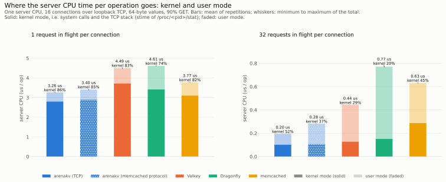

# Benchmarks

Measurements of `arenakv`, `kvpace` and `rdmaduct`, and of the established servers they are compared with, with
the raw data, the scripts that produced it, and checks that tie every published number and statement to that data.

| Item | Location |
|---|---|
| Raw results, environment and manifest of every run | [`data/`](data) |
| Figures (light and dark variants) | [`figures/`](figures) |
| Tables generated from the raw data | [`generated/`](generated) and the blocks below |
| Method, definitions, threats to validity | [`METHODOLOGY.md`](METHODOLOGY.md) |
| Orchestrator, report generator, verifier, claim definitions | [`tools/`](tools) |

The run described here is `data/<run>` where `<run>` is the name in [`LATEST`](LATEST).

## How to read this page

- Every figure has a table with the same data directly below it (the table view). Tables show the mean of the
  repetitions and, in parentheses, the coefficient of variation (`cv`).
- Figures show the mean with a whisker from the minimum to the maximum repetition.
- Statements such as "[C1]" are checked against the data by `tools/verify.py`; `tools/claims.py` contains the exact
  condition.
- All measurements come from **one machine** with **default configurations** and the **`performance` CPU governor**
  (run3; run1 and run2 used `powersave`).
  The server and the load generator share the machine and communicate over loopback. The RDMA rows use **Soft-RoCE**
  (software RDMA); they say nothing about RDMA hardware. Read [`METHODOLOGY.md`](METHODOLOGY.md#threats-to-validity)
  before drawing conclusions.

## Environment of the run

<!-- BEGIN GENERATED:environment -->
| Item | Value |
|---|---|
| Run | 2026-10-21-run3 |
| Date (UTC) | 2026-10-21T07:59:18Z |
| CPU | 12th Gen Intel(R) Core(TM) i9-12900K |
| Logical CPUs | 24 |
| CPU governor | performance |
| Memory | 31.1 GiB |
| Kernel | 7.0.0-34-generic |
| OS | Ubuntu 24.04.5 LTS |
| Compiler | cc (Ubuntu 13.3.0-6ubuntu2~24.04.1) 13.3.0 |
| Network interface | enp4s0, 1000 Mbit/s |
| RDMA devices | link rxe0/1 state ACTIVE physical_state LINK_UP netdev enp4s0 |
| Valkey | Valkey server v=9.1.2 sha=00000000:0 malloc=jemalloc-5.3.0 bits=64 build=16129465b18d72a |
| Dragonfly | dragonfly v2.0.2-8ce4bbb106586057fbd85f71ed353c60d0d5bf87 |
| memcached | memcached 1.6.45 |
| Container runtime | Docker 29.9.0 |
| Source commit | cb8f60b7eaa0 |
| Uncommitted files at run start | 0 |
<!-- END GENERATED:environment -->

Provenance of the run directory: every suite ran from the source commit above with a clean working tree, in the order
matrix, sweep, pipeline, connections, capacity, engine, transport, validation, then `capacity-evict` (Dragonfly with a
raised eviction flag) into the same directory with the same binaries. The server arguments are those of
`tools/run.py` and `kvpace/scripts/servers.sh` at that commit and are recorded in the manifest. The system ids
`kvstore`, `kvstore-rdma` and `kvstore-mc` in the raw data name arenakv over TCP, over Soft-RoCE and serving the
memcached text protocol. The CPU governor in `env.json` is that of CPU 0; the run started only after all 24 CPUs reported `performance`.
Later runs record the distinct governors of all CPUs. Containers unrelated to the benchmark were
stopped for the duration of the run; this run's `env.json` does not record it, later runs record the number of
running containers and the load average at the start.

Earlier runs stay in the repository unchanged:
`data/2026-10-21-run2` measured the server and transport before the TCP path changes described in
[`rdmaduct/docs/ARCHITECTURE.md`](../rdmaduct/docs/ARCHITECTURE.md), with the `powersave` governor, and did not
record the kernel-mode part of the server CPU time; `data/2026-10-20-run1` measured the earlier server version (one
thread per connection, index sized from the capacity), and its server CPU per KV-cache operation is computed from its
raw counters (see `tools/bench_data.py`).

## 1. Throughput of the servers

<picture>
  <source media="(prefers-color-scheme: dark)" srcset="figures/throughput-dark.svg">
  
</picture>

<!-- BEGIN GENERATED:matrix-throughput -->
Data: `benchmarks/data/2026-10-21-run3` (690 runs: 660 ok, 20 with operation errors, 0 failed, 10 skipped), commit `cb8f60b7eaa0`, summary digest `c9976f2a8da5b83b`. Mean over repetitions; `cv` is the coefficient of variation.

Operations per second (KV-cache rows: requests per second).

| Workload | Server CPUs | arenakv (TCP) | arenakv (Soft-RoCE) | arenakv (memcached protocol) | Valkey | Dragonfly | memcached |
|---|---|---|---|---|---|---|---|
| 64-byte values | 1 | 267,146 (cv 2.1%) | 226,389 (cv 0.9%) | 258,139 (cv 1.7%) | 210,691 (cv 1.5%) | 204,423 (cv 3.4%) | 232,434 (cv 0.9%) |
| 64-byte values | 4 | 723,389 (cv 4.4%) | 244,918 (cv 4.5%) | 805,570 (cv 1.2%) | 477,558 (cv 4.0%) | 529,566 (cv 2.1%) | 725,576 (cv 4.6%) |
| 16 KiB values | 1 | 157,518 (cv 3.9%) | 118,128 (cv 1.9%) | 159,958 (cv 0.8%) | 143,522 (cv 0.4%) | 136,874 (cv 0.6%) | 144,302 (cv 2.9%) |
| 16 KiB values | 4 | 510,367 (cv 3.9%) | 133,901 (cv 3.7%) | 517,462 (cv 6.8%) | 342,350 (cv 4.3%) | 377,634 (cv 6.3%) | 493,253 (cv 3.5%) |
| KV-cache requests | 1 | 2,034 (cv 2.3%) | 1,445 (cv 1.7%) | 1,993 (cv 0.7%) | 1,758 (cv 1.1%) | 1,772 (cv 5.1%) | 1,862 (cv 2.6%) |
| KV-cache requests | 4 | 4,704 (cv 3.2%) | 1,762 (cv 6.0%) | 4,864 (cv 2.4%) | 3,885 (cv 1.6%) | 2,340 (cv 5.0%) | 4,427 (cv 4.3%) |
<!-- END GENERATED:matrix-throughput -->

## 2. Server CPU per operation

<picture>
  <source media="(prefers-color-scheme: dark)" srcset="figures/cpu-per-op-dark.svg">
  
</picture>

<!-- BEGIN GENERATED:matrix-cpu -->
Data: `benchmarks/data/2026-10-21-run3` (690 runs: 660 ok, 20 with operation errors, 0 failed, 10 skipped), commit `cb8f60b7eaa0`, summary digest `c9976f2a8da5b83b`. Mean over repetitions; `cv` is the coefficient of variation.

Server CPU time per operation in microseconds (KV-cache rows: per block GET or PUT).

| Workload | Server CPUs | arenakv (TCP) | arenakv (Soft-RoCE) | arenakv (memcached protocol) | Valkey | Dragonfly | memcached |
|---|---|---|---|---|---|---|---|
| 64-byte values | 1 | 3.74 (cv 2.2%) | 4.42 (cv 0.9%) | 3.87 (cv 1.7%) | 4.75 (cv 1.6%) | 4.89 (cv 3.5%) | 4.30 (cv 0.9%) |
| 64-byte values | 4 | 5.13 (cv 4.9%) | 9.20 (cv 3.6%) | 4.92 (cv 1.2%) | 8.39 (cv 4.1%) | 7.39 (cv 2.2%) | 5.45 (cv 4.2%) |
| 16 KiB values | 1 | 6.35 (cv 4.0%) | 8.45 (cv 1.9%) | 6.25 (cv 0.8%) | 6.97 (cv 0.4%) | 7.30 (cv 0.6%) | 6.94 (cv 3.0%) |
| 16 KiB values | 4 | 7.74 (cv 3.9%) | 11.44 (cv 4.0%) | 7.68 (cv 6.4%) | 11.69 (cv 4.3%) | 10.32 (cv 6.3%) | 8.07 (cv 3.4%) |
| KV-cache requests | 1 | 6.34 (cv 2.5%) | 9.24 (cv 1.8%) | 6.49 (cv 0.7%) | 7.47 (cv 1.3%) | 7.42 (cv 5.9%) | 7.00 (cv 2.9%) |
| KV-cache requests | 4 | 8.38 (cv 4.1%) | 11.96 (cv 5.2%) | 8.60 (cv 2.5%) | 12.34 (cv 1.7%) | 12.68 (cv 3.0%) | 8.26 (cv 3.7%) |
<!-- END GENERATED:matrix-cpu -->

Latency in the closed loop (queueing at 16 connections, not latency at a given load):

<!-- BEGIN GENERATED:matrix-p99 -->
Data: `benchmarks/data/2026-10-21-run3` (690 runs: 660 ok, 20 with operation errors, 0 failed, 10 skipped), commit `cb8f60b7eaa0`, summary digest `c9976f2a8da5b83b`. Mean over repetitions; `cv` is the coefficient of variation.

GET latency p99 in microseconds in the closed loop (KV-cache rows: request latency).

| Workload | Server CPUs | arenakv (TCP) | arenakv (Soft-RoCE) | arenakv (memcached protocol) | Valkey | Dragonfly | memcached |
|---|---|---|---|---|---|---|---|
| 64-byte values | 1 | 118 (cv 2.2%) | 125 (cv 1.2%) | 121 (cv 1.6%) | 139 (cv 1.7%) | 111 (cv 14.3%) | 140 (cv 1.5%) |
| 64-byte values | 4 | 68 (cv 18.4%) | 377 (cv 26.3%) | 48 (cv 18.3%) | 205 (cv 40.7%) | 116 (cv 7.9%) | 80 (cv 20.1%) |
| 16 KiB values | 1 | 205 (cv 7.5%) | 306 (cv 3.9%) | 196 (cv 1.3%) | 152 (cv 1.5%) | 152 (cv 6.9%) | 236 (cv 8.8%) |
| 16 KiB values | 4 | 89 (cv 23.5%) | 900 (cv 8.9%) | 97 (cv 33.6%) | 190 (cv 64.1%) | 204 (cv 27.0%) | 141 (cv 4.2%) |
| KV-cache requests | 1 | 22,282 (cv 4.5%) | 25,585 (cv 6.7%) | 22,282 (cv 2.0%) | 19,268 (cv 1.7%) | 19,451 (cv 7.4%) | 24,432 (cv 4.8%) |
| KV-cache requests | 4 | 12,052 (cv 33.0%) | 39,846 (cv 32.6%) | 10,951 (cv 26.5%) | 14,523 (cv 27.7%) | 44,984 (cv 7.9%) | 11,318 (cv 27.9%) |
<!-- END GENERATED:matrix-p99 -->

Server resident memory at the end of each run:

<!-- BEGIN GENERATED:matrix-rss -->
Data: `benchmarks/data/2026-10-21-run3` (690 runs: 660 ok, 20 with operation errors, 0 failed, 10 skipped), commit `cb8f60b7eaa0`, summary digest `c9976f2a8da5b83b`. Mean over repetitions; `cv` is the coefficient of variation.

Server resident memory at the end of the run in MiB.

| Workload | Server CPUs | arenakv (TCP) | arenakv (Soft-RoCE) | arenakv (memcached protocol) | Valkey | Dragonfly | memcached |
|---|---|---|---|---|---|---|---|
| 64-byte values | 1 | 17 (cv 0.2%) | 50 (cv 0.0%) | 17 (cv 0.1%) | 23 (cv 0.4%) | 32 (cv 2.1%) | 21 (cv 0.3%) |
| 64-byte values | 4 | 17 (cv 0.3%) | 50 (cv 0.0%) | 17 (cv 0.1%) | 24 (cv 0.3%) | 34 (cv 2.1%) | 22 (cv 0.2%) |
| 16 KiB values | 1 | 318 (cv 0.0%) | 351 (cv 0.0%) | 318 (cv 0.0%) | 407 (cv 0.0%) | 339 (cv 0.2%) | 341 (cv 0.0%) |
| 16 KiB values | 4 | 318 (cv 0.0%) | 351 (cv 0.0%) | 318 (cv 0.0%) | 449 (cv 0.9%) | 345 (cv 0.0%) | 341 (cv 0.0%) |
| KV-cache requests | 1 | 2,988 (cv 1.6%) | 2,204 (cv 1.0%) | 2,913 (cv 0.6%) | 3,233 (cv 1.6%) | 2,640 (cv 4.3%) | 2,923 (cv 2.2%) |
| KV-cache requests | 4 | 7,220 (cv 2.3%) | 2,750 (cv 4.5%) | 7,362 (cv 2.6%) | 7,256 (cv 0.9%) | 4,624 (cv 2.7%) | 7,022 (cv 3.3%) |
<!-- END GENERATED:matrix-rss -->

## 3. Latency under offered load (open loop)

<picture>
  <source media="(prefers-color-scheme: dark)" srcset="figures/sweep-dark.svg">
  
</picture>

<!-- BEGIN GENERATED:sweep -->
Data: `benchmarks/data/2026-10-21-run3` (690 runs: 660 ok, 20 with operation errors, 0 failed, 10 skipped), commit `cb8f60b7eaa0`, summary digest `c9976f2a8da5b83b`. Mean over repetitions; `cv` is the coefficient of variation.

Open loop, one server CPU, 64-byte values, 16 connections. Latencies in microseconds, measured from the intended send time unless stated.

| System | Offered ops/s | Achieved ops/s | p50 | p99 | p99 service time | Max schedule lag (ms) |
|---|---|---|---|---|---|---|
| arenakv (TCP) | 20,000 | 20,000 (cv 0.0%) | 9 (cv 3.1%) | 175 (cv 89.8%) | 116 (cv 72.2%) | 4.2 (cv 9.5%) |
| arenakv (TCP) | 60,000 | 60,000 (cv 0.0%) | 54 (cv 42.1%) | 765 (cv 25.8%) | 494 (cv 12.0%) | 4.6 (cv 23.5%) |
| arenakv (TCP) | 100,000 | 100,001 (cv 0.0%) | 219 (cv 7.0%) | 1,915 (cv 34.1%) | 709 (cv 10.3%) | 13.6 (cv 79.4%) |
| arenakv (TCP) | 140,000 | 139,998 (cv 0.0%) | 218 (cv 25.1%) | 3,106 (cv 41.2%) | 665 (cv 14.3%) | 17.7 (cv 57.0%) |
| arenakv (TCP) | 180,000 | 179,999 (cv 0.0%) | 190 (cv 8.1%) | 2,772 (cv 15.8%) | 532 (cv 1.8%) | 17.4 (cv 88.7%) |
| arenakv (TCP) | 220,000 | 219,999 (cv 0.0%) | 122 (cv 6.2%) | 1,753 (cv 14.6%) | 346 (cv 5.7%) | 13.3 (cv 79.6%) |
| arenakv (TCP) | 260,000 | 260,015 (cv 0.0%) | 93 (cv 6.6%) | 13,310 (cv 112.6%) | 149 (cv 9.5%) | 30.1 (cv 89.1%) |
| Valkey | 20,000 | 20,000 (cv 0.0%) | 10 (cv 2.3%) | 200 (cv 55.7%) | 95 (cv 31.4%) | 4.1 (cv 14.6%) |
| Valkey | 60,000 | 60,000 (cv 0.0%) | 113 (cv 32.0%) | 1,195 (cv 62.7%) | 608 (cv 4.6%) | 14.3 (cv 110.0%) |
| Valkey | 100,000 | 100,000 (cv 0.0%) | 341 (cv 10.7%) | 5,865 (cv 17.5%) | 906 (cv 4.3%) | 25.9 (cv 89.3%) |
| Valkey | 140,000 | 140,004 (cv 0.0%) | 172 (cv 2.4%) | 3,994 (cv 58.6%) | 535 (cv 1.3%) | 64.8 (cv 69.6%) |
| Valkey | 180,000 | 180,016 (cv 0.0%) | 99 (cv 3.5%) | 1,339 (cv 30.1%) | 305 (cv 2.5%) | 27.9 (cv 92.1%) |
| Valkey | 220,000 | 210,520 (cv 0.9%) | 242,011 (cv 11.4%) | 400,975 (cv 15.2%) | 140 (cv 1.0%) | 418.5 (cv 14.1%) |
| Valkey | 260,000 | 211,542 (cv 0.4%) | 927,780 (cv 2.2%) | 1,488,139 (cv 2.1%) | 139 (cv 0.6%) | 1,521.3 (cv 2.8%) |
| Dragonfly | 20,000 | 20,000 (cv 0.0%) | 10 (cv 6.1%) | 385 (cv 68.7%) | 222 (cv 61.6%) | 3.5 (cv 10.9%) |
| Dragonfly | 60,000 | 60,004 (cv 0.0%) | 87 (cv 42.6%) | 1,098 (cv 33.7%) | 550 (cv 9.9%) | 29.2 (cv 27.4%) |
| Dragonfly | 100,000 | 99,995 (cv 0.0%) | 498 (cv 8.8%) | 7,759 (cv 12.8%) | 880 (cv 7.2%) | 52.1 (cv 69.0%) |
| Dragonfly | 140,000 | 140,003 (cv 0.0%) | 263 (cv 3.6%) | 4,912 (cv 25.9%) | 478 (cv 11.5%) | 47.3 (cv 101.7%) |
| Dragonfly | 180,000 | 180,005 (cv 0.0%) | 168 (cv 31.9%) | 38,676 (cv 130.1%) | 192 (cv 15.4%) | 64.9 (cv 98.6%) |
| Dragonfly | 220,000 | 210,165 (cv 0.7%) | 241,172 (cv 9.8%) | 406,428 (cv 8.5%) | 95 (cv 3.3%) | 413.6 (cv 7.8%) |
| Dragonfly | 260,000 | 210,926 (cv 0.4%) | 957,140 (cv 2.1%) | 1,533,438 (cv 2.4%) | 95 (cv 3.6%) | 1,568.5 (cv 3.1%) |
| memcached | 20,000 | 20,000 (cv 0.0%) | 9 (cv 3.1%) | 219 (cv 11.4%) | 176 (cv 23.4%) | 3.5 (cv 17.0%) |
| memcached | 60,000 | 60,000 (cv 0.0%) | 77 (cv 49.4%) | 766 (cv 10.6%) | 546 (cv 12.1%) | 14.9 (cv 54.7%) |
| memcached | 100,000 | 99,999 (cv 0.0%) | 358 (cv 14.1%) | 6,455 (cv 25.2%) | 1,022 (cv 2.4%) | 43.7 (cv 66.3%) |
| memcached | 140,000 | 140,004 (cv 0.0%) | 272 (cv 4.8%) | 4,044 (cv 27.7%) | 704 (cv 2.4%) | 31.9 (cv 118.6%) |
| memcached | 180,000 | 179,895 (cv 0.1%) | 177 (cv 6.3%) | 23,976 (cv 118.5%) | 465 (cv 5.8%) | 95.9 (cv 65.8%) |
| memcached | 220,000 | 220,006 (cv 0.1%) | 104 (cv 4.4%) | 19,238 (cv 96.7%) | 219 (cv 8.0%) | 48.0 (cv 65.9%) |
| memcached | 260,000 | 229,650 (cv 3.0%) | 554,068 (cv 24.2%) | 1,212,154 (cv 15.5%) | 141 (cv 7.3%) | 1,311.2 (cv 15.9%) |
<!-- END GENERATED:sweep -->

Why latency is measured from the intended send time:

<picture>
  <source media="(prefers-color-scheme: dark)" srcset="figures/coordinated-omission-dark.svg">
  
</picture>

## 4. Pipelining and connection count

Closed loop, one server CPU, 64-byte values, 90% GET, 4 client threads. Left: 16 connections with 1, 8 or 32
requests in flight each. Middle and right: 16 to 1024 connections, one request in flight each.

<picture>
  <source media="(prefers-color-scheme: dark)" srcset="figures/concurrency-dark.svg">
  
</picture>

<!-- BEGIN GENERATED:pipeline -->
Data: `benchmarks/data/2026-10-21-run3` (690 runs: 660 ok, 20 with operation errors, 0 failed, 10 skipped), commit `cb8f60b7eaa0`, summary digest `c9976f2a8da5b83b`. Mean over repetitions; `cv` is the coefficient of variation.

Closed loop, one server CPU, 64-byte values, 90% GET, 16 connections from 4 client threads, with the given number of requests in flight per connection. Latencies are GET latencies in microseconds. Server kernel share: kernel-mode part of the server CPU time (stime in /proc/<pid>/stat), that is system calls and the TCP stack run on the server's behalf.

| System | Depth | ops/s | p50 | p99 | Server CPU µs/op | Server kernel share | Server RSS MiB |
|---|---|---|---|---|---|---|---|
| arenakv (TCP) | 1 | 308,298 (cv 0.2%) | 48 (cv 0.2%) | 100 (cv 0.6%) | 3.24 (cv 0.4%) | 86% (cv 0.3%) | 17 (cv 0.0%) |
| arenakv (TCP) | 8 | 2,036,734 (cv 0.6%) | 57 (cv 0.8%) | 121 (cv 0.5%) | 0.49 (cv 0.6%) | 74% (cv 0.8%) | 17 (cv 0.1%) |
| arenakv (TCP) | 32 | 5,265,280 (cv 0.7%) | 87 (cv 1.0%) | 186 (cv 0.9%) | 0.19 (cv 0.6%) | 53% (cv 1.8%) | 17 (cv 0.1%) |
| arenakv (memcached protocol) | 1 | 295,667 (cv 0.6%) | 50 (cv 0.8%) | 105 (cv 0.6%) | 3.38 (cv 0.6%) | 85% (cv 0.2%) | 17 (cv 0.2%) |
| arenakv (memcached protocol) | 8 | 1,717,097 (cv 0.4%) | 69 (cv 0.6%) | 144 (cv 0.3%) | 0.58 (cv 0.4%) | 64% (cv 1.2%) | 17 (cv 0.3%) |
| arenakv (memcached protocol) | 32 | 3,626,581 (cv 0.4%) | 129 (cv 0.5%) | 273 (cv 0.8%) | 0.28 (cv 0.4%) | 38% (cv 1.3%) | 17 (cv 0.1%) |
| Valkey | 1 | 221,048 (cv 0.6%) | 67 (cv 0.4%) | 134 (cv 0.4%) | 4.52 (cv 0.7%) | 83% (cv 0.9%) | 23 (cv 0.4%) |
| Valkey | 8 | 1,162,288 (cv 0.4%) | 101 (cv 0.4%) | 170 (cv 1.9%) | 0.86 (cv 0.4%) | 56% (cv 1.8%) | 23 (cv 0.3%) |
| Valkey | 32 | 2,239,084 (cv 0.5%) | 187 (cv 0.5%) | 348 (cv 0.9%) | 0.45 (cv 0.4%) | 30% (cv 0.7%) | 23 (cv 0.4%) |
| Dragonfly | 1 | 215,365 (cv 0.6%) | 73 (cv 0.8%) | 93 (cv 3.6%) | 4.64 (cv 0.5%) | 74% (cv 0.6%) | 32 (cv 2.4%) |
| Dragonfly | 8 | 816,860 (cv 0.3%) | 143 (cv 0.3%) | 249 (cv 1.6%) | 1.23 (cv 0.4%) | 38% (cv 1.3%) | 32 (cv 0.2%) |
| Dragonfly | 32 | 1,299,547 (cv 0.6%) | 350 (cv 0.6%) | 661 (cv 1.2%) | 0.77 (cv 0.6%) | 19% (cv 4.2%) | 33 (cv 0.3%) |
| memcached | 1 | 265,316 (cv 0.4%) | 54 (cv 0.5%) | 119 (cv 0.6%) | 3.77 (cv 0.4%) | 81% (cv 0.3%) | 21 (cv 0.2%) |
| memcached | 8 | 1,221,762 (cv 0.6%) | 87 (cv 0.8%) | 281 (cv 0.9%) | 0.82 (cv 0.7%) | 56% (cv 0.9%) | 21 (cv 0.2%) |
| memcached | 32 | 1,570,030 (cv 0.8%) | 285 (cv 0.5%) | 570 (cv 3.5%) | 0.64 (cv 0.8%) | 45% (cv 1.3%) | 22 (cv 0.4%) |
<!-- END GENERATED:pipeline -->

The server CPU time per operation of the pipeline table, split into kernel mode and user mode (columns "Server CPU
µs/op" and "Server kernel share"):

<picture>
  <source media="(prefers-color-scheme: dark)" srcset="figures/cpu-split-dark.svg">
  
</picture>

<!-- BEGIN GENERATED:connections -->
Data: `benchmarks/data/2026-10-21-run3` (690 runs: 660 ok, 20 with operation errors, 0 failed, 10 skipped), commit `cb8f60b7eaa0`, summary digest `c9976f2a8da5b83b`. Mean over repetitions; `cv` is the coefficient of variation.

Closed loop, one server CPU, 64-byte values, 90% GET, connections spread over 4 client threads, one request in flight per connection. Latencies are GET latencies in microseconds. Server kernel share: kernel-mode part of the server CPU time (stime in /proc/<pid>/stat), that is system calls and the TCP stack run on the server's behalf.

| System | Connections | ops/s | p50 | p99 | Server CPU µs/op | Server kernel share | Server RSS MiB |
|---|---|---|---|---|---|---|---|
| arenakv (TCP) | 16 | 305,443 (cv 2.2%) | 48 (cv 1.9%) | 102 (cv 2.7%) | 3.27 (cv 2.2%) | 85% (cv 1.5%) | 17 (cv 0.2%) |
| arenakv (TCP) | 64 | 316,202 (cv 1.7%) | 194 (cv 1.4%) | 396 (cv 1.7%) | 3.16 (cv 1.8%) | 84% (cv 1.8%) | 17 (cv 0.1%) |
| arenakv (TCP) | 256 | 314,839 (cv 0.4%) | 808 (cv 0.4%) | 888 (cv 2.4%) | 3.18 (cv 0.4%) | 83% (cv 0.6%) | 19 (cv 0.1%) |
| arenakv (TCP) | 1,024 | 293,097 (cv 1.0%) | 3,421 (cv 0.8%) | 4,666 (cv 4.8%) | 3.41 (cv 0.9%) | 80% (cv 0.7%) | 27 (cv 0.1%) |
| arenakv (memcached protocol) | 16 | 295,820 (cv 0.3%) | 50 (cv 0.6%) | 104 (cv 0.4%) | 3.38 (cv 0.3%) | 85% (cv 0.9%) | 17 (cv 0.2%) |
| arenakv (memcached protocol) | 64 | 302,849 (cv 0.7%) | 204 (cv 0.6%) | 412 (cv 0.8%) | 3.30 (cv 0.6%) | 84% (cv 0.5%) | 17 (cv 0.1%) |
| arenakv (memcached protocol) | 256 | 298,285 (cv 0.8%) | 854 (cv 0.7%) | 938 (cv 1.5%) | 3.35 (cv 0.8%) | 83% (cv 1.1%) | 19 (cv 0.2%) |
| arenakv (memcached protocol) | 1,024 | 293,182 (cv 0.9%) | 3,447 (cv 1.0%) | 4,476 (cv 4.4%) | 3.41 (cv 1.0%) | 81% (cv 0.5%) | 25 (cv 0.0%) |
| Valkey | 16 | 222,157 (cv 0.6%) | 67 (cv 0.5%) | 133 (cv 0.5%) | 4.50 (cv 0.6%) | 83% (cv 0.5%) | 23 (cv 0.3%) |
| Valkey | 64 | 229,176 (cv 0.6%) | 269 (cv 0.3%) | 546 (cv 0.4%) | 4.36 (cv 0.6%) | 82% (cv 0.6%) | 23 (cv 0.3%) |
| Valkey | 256 | 220,906 (cv 6.9%) | 1,134 (cv 7.5%) | 2,284 (cv 7.5%) | 4.55 (cv 7.6%) | 81% (cv 0.4%) | 24 (cv 0.4%) |
| Valkey | 1,024 | 222,453 (cv 4.1%) | 4,470 (cv 3.5%) | 8,913 (cv 3.3%) | 4.50 (cv 4.4%) | 79% (cv 0.9%) | 26 (cv 2.8%) |
| Dragonfly | 16 | 215,452 (cv 1.5%) | 73 (cv 1.4%) | 92 (cv 4.8%) | 4.64 (cv 1.6%) | 74% (cv 0.8%) | 31 (cv 0.3%) |
| Dragonfly | 64 | 212,071 (cv 0.2%) | 300 (cv 0.4%) | 338 (cv 1.4%) | 4.71 (cv 0.3%) | 74% (cv 0.7%) | 34 (cv 2.3%) |
| Dragonfly | 256 | 209,450 (cv 0.5%) | 1,221 (cv 0.5%) | 1,362 (cv 1.6%) | 4.78 (cv 0.5%) | 72% (cv 0.7%) | 42 (cv 1.4%) |
| Dragonfly | 1,024 | 178,908 (cv 6.3%) | 5,643 (cv 7.1%) | 7,818 (cv 4.6%) | 5.61 (cv 6.9%) | 65% (cv 2.0%) | 75 (cv 1.1%) |
| memcached | 16 | 265,949 (cv 0.6%) | 54 (cv 0.7%) | 120 (cv 0.6%) | 3.76 (cv 0.6%) | 82% (cv 0.7%) | 21 (cv 0.3%) |
| memcached | 64 | 271,502 (cv 0.6%) | 224 (cv 0.6%) | 459 (cv 0.6%) | 3.68 (cv 0.5%) | 82% (cv 0.8%) | 21 (cv 0.2%) |
| memcached | 256 | 261,604 (cv 2.9%) | 961 (cv 2.7%) | 1,674 (cv 14.3%) | 3.82 (cv 3.0%) | 79% (cv 2.7%) | 22 (cv 0.2%) |
| memcached | 1,024 | 258,673 (cv 0.8%) | 3,880 (cv 0.6%) | 5,675 (cv 9.9%) | 3.86 (cv 0.8%) | 77% (cv 0.4%) | 22 (cv 0.2%) |
<!-- END GENERATED:connections -->

## 5. KV-cache workload: reuse versus capacity

<picture>
  <source media="(prefers-color-scheme: dark)" srcset="figures/capacity-dark.svg">
  
</picture>

<!-- BEGIN GENERATED:capacity-reuse -->
Data: `benchmarks/data/2026-10-21-run3` (690 runs: 660 ok, 20 with operation errors, 0 failed, 10 skipped), commit `cb8f60b7eaa0`, summary digest `c9976f2a8da5b83b`. Mean over repetitions; `cv` is the coefficient of variation.

KV-cache scenario, reuse rate (fraction of needed blocks served from the cache) by configured capacity.

| System | 16 MB | 64 MB | 256 MB | 1 GB | 4 GB |
|---|---|---|---|---|---|
| arenakv (TCP) | 0.182 (cv 1.3%) | 0.429 (cv 0.3%) | 0.642 (cv 0.2%) | 0.822 (cv 0.2%) | 0.904 (cv 0.0%) |
| Valkey | 0.036 (cv 5.5%) | 0.115 (cv 3.0%) | 0.307 (cv 0.9%) | 0.789 (cv 0.2%) | 0.902 (cv 0.0%) |
| Dragonfly | n/a | n/a | 0.408 (cv 0.9%) | 0.685 (cv 0.5%) | 0.902 (cv 0.0%) |
| Dragonfly (eviction flag raised) | n/a | n/a | 0.436 (cv 0.5%) | 0.599 (cv 0.6%) | 0.902 (cv 0.0%) |
| memcached | 0.354 (cv 0.3%) | 0.497 (cv 0.2%) | 0.663 (cv 0.2%) | 0.845 (cv 0.1%) | 0.903 (cv 0.0%) |
<!-- END GENERATED:capacity-reuse -->

<!-- BEGIN GENERATED:capacity-throughput -->
Data: `benchmarks/data/2026-10-21-run3` (690 runs: 660 ok, 20 with operation errors, 0 failed, 10 skipped), commit `cb8f60b7eaa0`, summary digest `c9976f2a8da5b83b`. Mean over repetitions; `cv` is the coefficient of variation.

KV-cache scenario, requests per second by configured capacity.

| System | 16 MB | 64 MB | 256 MB | 1 GB | 4 GB |
|---|---|---|---|---|---|
| arenakv (TCP) | 2,334 (cv 0.9%) | 2,040 (cv 0.4%) | 1,987 (cv 0.6%) | 1,968 (cv 0.7%) | 1,952 (cv 0.4%) |
| Valkey | 1,970 (cv 0.3%) | 1,827 (cv 0.7%) | 1,751 (cv 0.4%) | 1,685 (cv 0.4%) | 1,626 (cv 0.3%) |
| Dragonfly | n/a | n/a | 173 (cv 1.5%) | 513 (cv 1.0%) | 1,688 (cv 0.4%) |
| Dragonfly (eviction flag raised) | n/a | n/a | 1,653 (cv 0.3%) | 1,644 (cv 0.1%) | 1,686 (cv 0.2%) |
| memcached | 2,018 (cv 1.3%) | 1,905 (cv 0.4%) | 1,880 (cv 1.2%) | 1,883 (cv 0.5%) | 1,776 (cv 1.3%) |
<!-- END GENERATED:capacity-throughput -->

Share of requests that failed because the server rejected an operation:

<!-- BEGIN GENERATED:capacity-errors -->
Data: `benchmarks/data/2026-10-21-run3` (690 runs: 660 ok, 20 with operation errors, 0 failed, 10 skipped), commit `cb8f60b7eaa0`, summary digest `c9976f2a8da5b83b`. Mean over repetitions; `cv` is the coefficient of variation.

Share of KV-cache requests that failed (an operation was rejected by the server, for example with an out-of-memory error), by configured capacity.

| System | 16 MB | 64 MB | 256 MB | 1 GB | 4 GB |
|---|---|---|---|---|---|
| arenakv (TCP) | 0.00% | 0.00% | 0.00% | 0.00% | 0.00% |
| Valkey | 0.00% | 0.00% | 0.00% | 0.00% | 0.00% |
| Dragonfly | n/a | n/a | 96.24% | 85.69% | 0.00% |
| Dragonfly (eviction flag raised) | n/a | n/a | 0.00% | 0.00% | 0.00% |
| memcached | 0.01% | 0.01% | 0.00% | 0.00% | 0.00% |
<!-- END GENERATED:capacity-errors -->

<!-- BEGIN GENERATED:capacity-skipped -->
Skipped configurations: dragonfly at 16mb (dragonfly refuses to start with less than 256 MiB per thread); dragonfly at 64mb (dragonfly refuses to start with less than 256 MiB per thread).
<!-- END GENERATED:capacity-skipped -->

## 6. arenakv engine

<picture>
  <source media="(prefers-color-scheme: dark)" srcset="figures/engine-dark.svg">
  
</picture>

<!-- BEGIN GENERATED:engine-scale -->
Data: `benchmarks/data/2026-10-21-run3` (690 runs: 660 ok, 20 with operation errors, 0 failed, 10 skipped), commit `cb8f60b7eaa0`, summary digest `c9976f2a8da5b83b`. Mean over repetitions; `cv` is the coefficient of variation.

Engine operations per second (90% GET, uniform keys, key space preloaded, no eviction).

| Value size | 1 threads | 2 threads | 4 threads | 8 threads | 12 threads | 16 threads |
|---|---|---|---|---|---|---|
| 64-byte values | 3,755,944 (cv 1.4%) | 6,646,938 (cv 1.1%) | 11,480,767 (cv 1.6%) | 18,632,091 (cv 1.8%) | 22,429,186 (cv 1.4%) | 23,051,921 (cv 7.0%) |
| 4096-byte values | 1,516,694 (cv 0.5%) | 2,506,579 (cv 0.8%) | 3,883,060 (cv 0.7%) | 5,361,826 (cv 0.7%) | 5,721,626 (cv 0.9%) | 5,901,489 (cv 4.8%) |
<!-- END GENERATED:engine-scale -->

<!-- BEGIN GENERATED:engine-micro -->
Data: `benchmarks/data/2026-10-21-run3` (690 runs: 660 ok, 20 with operation errors, 0 failed, 10 skipped), commit `cb8f60b7eaa0`, summary digest `c9976f2a8da5b83b`. Mean over repetitions; `cv` is the coefficient of variation.

| Measurement | Result |
|---|---|
| 16-lane tag comparison, vector (sse2) | 0.671 ns (cv 4.1%) |
| 16-lane tag comparison, scalar reference | 8.208 ns (cv 0.5%) |
| Speedup of the vector version | 12.3x (cv 4.4%) |
| Key hash, 8-byte key | 3.00 ns (cv 1.4%) |
| Key hash, 16-byte key | 4.13 ns (cv 0.8%) |
| Key hash, 32-byte key | 6.49 ns (cv 0.9%) |
| Key hash, 64-byte key | 11.15 ns (cv 0.8%) |
| Key hash, 256-byte key | 39.46 ns (cv 0.8%) |
| Key hash, 1024-byte key | 151.78 ns (cv 1.0%) |
| Key hash, 4096-byte key | 603.45 ns (cv 0.8%) |
<!-- END GENERATED:engine-micro -->

## 7. rdmaduct transport (loopback on one host)

<picture>
  <source media="(prefers-color-scheme: dark)" srcset="figures/transport-dark.svg">
  
</picture>

<!-- BEGIN GENERATED:transport-rtt -->
Data: `benchmarks/data/2026-10-21-run3` (690 runs: 660 ok, 20 with operation errors, 0 failed, 10 skipped), commit `cb8f60b7eaa0`, summary digest `c9976f2a8da5b83b`. Mean over repetitions; `cv` is the coefficient of variation.

Median round-trip time in microseconds (ping-pong, one message in flight). Loopback on one host.

| Message bytes | TCP | Soft-RoCE, polling | Soft-RoCE, event-driven |
|---|---|---|---|
| 64 | 7.3 (cv 1.6%) | 7.0 (cv 9.2%) | 10.2 (cv 7.5%) |
| 256 | 7.1 (cv 3.3%) | 6.6 (cv 2.4%) | 10.0 (cv 2.8%) |
| 1024 | 7.6 (cv 4.4%) | 6.7 (cv 1.9%) | 10.5 (cv 3.2%) |
| 4096 | 8.4 (cv 2.5%) | 11.1 (cv 1.9%) | 15.3 (cv 3.2%) |
| 16384 | 11.1 (cv 5.2%) | 30.2 (cv 3.0%) | 34.4 (cv 2.2%) |
| 65536 | 22.1 (cv 2.6%) | 110.9 (cv 8.4%) | 112.5 (cv 0.8%) |
| 262144 | 49.2 (cv 8.5%) | 440.4 (cv 1.6%) | 450.9 (cv 1.2%) |
| 1048576 | 181.9 (cv 2.0%) | 1,864.1 (cv 1.0%) | 1,927.9 (cv 1.2%) |
<!-- END GENERATED:transport-rtt -->

<!-- BEGIN GENERATED:transport-rtt-p99 -->
Data: `benchmarks/data/2026-10-21-run3` (690 runs: 660 ok, 20 with operation errors, 0 failed, 10 skipped), commit `cb8f60b7eaa0`, summary digest `c9976f2a8da5b83b`. Mean over repetitions; `cv` is the coefficient of variation.

p99 round-trip time in microseconds. Loopback on one host.

| Message bytes | TCP | Soft-RoCE, polling | Soft-RoCE, event-driven |
|---|---|---|---|
| 64 | 14.1 (cv 20.4%) | 9.3 (cv 13.7%) | 13.0 (cv 10.8%) |
| 256 | 10.3 (cv 31.0%) | 7.9 (cv 3.6%) | 12.1 (cv 6.6%) |
| 1024 | 15.3 (cv 39.1%) | 7.9 (cv 2.9%) | 13.2 (cv 1.8%) |
| 4096 | 13.3 (cv 29.6%) | 13.9 (cv 7.3%) | 18.7 (cv 5.5%) |
| 16384 | 14.7 (cv 28.8%) | 36.3 (cv 11.9%) | 43.6 (cv 6.8%) |
| 65536 | 49.8 (cv 57.9%) | 125.1 (cv 4.3%) | 154.0 (cv 8.0%) |
| 262144 | 69.4 (cv 43.3%) | 552.9 (cv 14.4%) | 672.6 (cv 6.7%) |
| 1048576 | 305.2 (cv 48.7%) | 2,082.4 (cv 5.4%) | 2,651.0 (cv 12.7%) |
<!-- END GENERATED:transport-rtt-p99 -->

<!-- BEGIN GENERATED:transport-stream -->
Data: `benchmarks/data/2026-10-21-run3` (690 runs: 660 ok, 20 with operation errors, 0 failed, 10 skipped), commit `cb8f60b7eaa0`, summary digest `c9976f2a8da5b83b`. Mean over repetitions; `cv` is the coefficient of variation.

One-way streaming throughput in MB/s (batched sends, 64 buffers per direction). Loopback on one host.

| Message bytes | TCP | Soft-RoCE, polling | Soft-RoCE, event-driven |
|---|---|---|---|
| 64 | 301 (cv 17.0%) | 47 (cv 1.7%) | 47 (cv 5.0%) |
| 256 | 1,203 (cv 17.1%) | 190 (cv 5.8%) | 172 (cv 8.8%) |
| 1024 | 3,509 (cv 2.8%) | 763 (cv 3.8%) | 665 (cv 9.0%) |
| 4096 | 8,181 (cv 1.6%) | 930 (cv 4.7%) | 952 (cv 2.5%) |
| 16384 | 11,527 (cv 2.7%) | 1,154 (cv 2.6%) | 1,146 (cv 1.6%) |
| 65536 | 9,865 (cv 11.8%) | 1,300 (cv 2.0%) | 1,270 (cv 1.3%) |
| 262144 | 5,430 (cv 13.4%) | 1,196 (cv 4.7%) | 1,193 (cv 2.2%) |
| 1048576 | 5,892 (cv 33.2%) | 1,139 (cv 2.5%) | 1,102 (cv 2.2%) |
<!-- END GENERATED:transport-stream -->

## 8. Validation of the load generator

`kvpace` against `memtier_benchmark` on the same server and settings (see
[`../kvpace/docs/validation.md`](../kvpace/docs/validation.md)):

<!-- BEGIN GENERATED:validation -->
Data: `benchmarks/data/2026-10-21-run3` (690 runs: 660 ok, 20 with operation errors, 0 failed, 10 skipped), commit `cb8f60b7eaa0`, summary digest `c9976f2a8da5b83b`. Mean over repetitions; `cv` is the coefficient of variation.

One server CPU, 64-byte values, 90% GET. memtier_benchmark runs `-t 1 -c 1` for one connection and `-t 4 -c 4` for 16. Latencies are GET latencies in microseconds; memtier reports milliseconds with three decimals.

| Server | Connections | kvpace client model | kvpace ops/s | memtier ops/s | Ratio | kvpace p50 | memtier p50 | kvpace p99 | memtier p99 |
|---|---|---|---|---|---|---|---|---|---|
| Valkey (RESP) | 1 | 1 thread, 1 connection | 116,950 (cv 0.7%) | 89,760 (cv 0.3%) | 1.30 | 8.4 (cv 0.4%) | 15.0 (cv 0.0%) | 11 (cv 2.4%) | 15 (cv 0.0%) |
| Valkey (RESP) | 16 | 4 threads x 4 connections | 221,077 (cv 0.5%) | 227,432 (cv 0.2%) | 0.97 | 67.3 (cv 0.4%) | 71.0 (cv 0.0%) | 134 (cv 0.4%) | 95 (cv 0.0%) |
| Valkey (RESP) | 16 | 16 threads x 1 connection | 210,438 (cv 0.9%) | 227,432 (cv 0.2%) | 0.93 | 72.8 (cv 0.6%) | 71.0 (cv 0.0%) | 139 (cv 0.8%) | 95 (cv 0.0%) |
| arenakv (memcached protocol) | 1 | 1 thread, 1 connection | 136,463 (cv 1.3%) | 102,194 (cv 0.7%) | 1.34 | 7.2 (cv 1.3%) | 15.0 (cv 0.0%) | 10 (cv 1.7%) | 15 (cv 0.0%) |
| arenakv (memcached protocol) | 16 | 4 threads x 4 connections | 296,016 (cv 0.1%) | 294,108 (cv 0.7%) | 1.01 | 49.6 (cv 0.3%) | 48.6 (cv 7.4%) | 104 (cv 0.6%) | 105 (cv 3.4%) |
| arenakv (memcached protocol) | 16 | 16 threads x 1 connection | 258,259 (cv 0.8%) | 294,108 (cv 0.7%) | 0.88 | 57.9 (cv 1.0%) | 48.6 (cv 7.4%) | 120 (cv 0.6%) | 105 (cv 3.4%) |
<!-- END GENERATED:validation -->

## Findings

Each statement below is checked against the data (tag `[C<n>]`, definition in [`tools/claims.py`](tools/claims.py)).
Differences are stated only for means or, where noted, for non-overlapping repetition ranges.

**Closed-loop throughput and server CPU (loopback, TCP)**

- arenakv over TCP, with its native protocol or with the memcached protocol, has the highest mean throughput in all
  six rows of the matrix [C1]. At one server CPU arenakv over the memcached protocol is faster than memcached in all
  three workloads, with non-overlapping ranges [C3]; both serve the same protocol to the same client, so the
  difference is the server.
- At four server CPUs the throughput of arenakv over its native protocol is higher than that of Valkey and of
  Dragonfly in all three workloads, with non-overlapping ranges [C2]. The four-CPU rows may be limited by the load
  generator (see [`METHODOLOGY.md`](METHODOLOGY.md#threats-to-validity)), so they show the order of the systems
  under this client, not server capacity.
- One of the two arenakv TCP rows has the lowest mean server CPU time per operation of the five TCP servers in five
  of the six rows; in the KV-cache row at four server CPUs memcached is lowest and native arenakv is within 2% of it
  [C4]. At four server CPUs arenakv over its native protocol uses less server CPU time per operation than Valkey and
  Dragonfly in all three workloads [C5]. The native protocol and the memcached protocol on the same server differ by
  less than 5% in server CPU time per operation in every row [C29]. In run2 (`data/2026-10-21-run2`) the native
  protocol cost more in every row [C32]; the TCP transport changes between the runs (one read per batch, byte-sized send
  batches, direct waiting without a second epoll set, delivery in place; see
  [`rdmaduct/docs/ARCHITECTURE.md`](../rdmaduct/docs/ARCHITECTURE.md)) removed that difference.
- arenakv over Soft-RoCE has lower mean throughput than arenakv over TCP in all six rows [C6]. Soft-RoCE is a software
  implementation sharing the CPUs with the load generator, so these rows say nothing about RDMA hardware.
- No operation failed in any matrix run [C22].
- With 64-byte values arenakv has a lower mean resident memory than each of Valkey, Dragonfly and memcached, below
  20 MiB, at one and at four server CPUs [C16]. In run1 it used more than eight times their memory [C33], because
  the index was sized from the configured capacity; the index now starts small and grows with the data.

**Latency under offered load (open loop, one server CPU, 64-byte values)**

- Up to 140,000 offered operations per second all four servers of the sweep achieve the offered rate within 1% [C8]. At
  260,000 offered operations per second, the highest rate of the sweep, arenakv (TCP) achieves the offered rate within
  1% in every repetition, while Valkey, Dragonfly and memcached achieve less than 240,000 operations per second in
  every repetition [C7]. The saturation rate of arenakv lies above the range of the sweep.
- At 260,000 offered operations per second the p99 latency measured from the intended send time exceeds the p99
  service time by more than a factor of 1,000 for Valkey, Dragonfly and memcached [C9]. A closed-loop or
  service-time-only measurement would hide this backlog; it is the reason latency is measured from the intended send
  time.
- Below saturation the p99 latency has a coefficient of variation above 20% between repetitions in at least half of the
  16 cells [C10]. Tail latencies at moderate load are noisy on this machine and must not be used to rank servers. The
  p99 curves are not monotonic between 100,000 and 220,000 operations per second [C36]. This run used the `performance`
  governor, so frequency scaling does not explain the shape; client thread scheduling is a hypothesis that was not
  tested.

**Pipelining and connection count (closed loop, one server CPU, 64-byte values)**

- At pipeline depth 32 native arenakv has the highest throughput of the five servers, with non-overlapping ranges, and
  at least twice the mean throughput of Valkey, Dragonfly and memcached [C24].
- From depth 1 to 32 the throughput of native arenakv grows by a factor above 15, that of arenakv over the memcached
  protocol and of Valkey by a factor between 9 and 13, and that of Dragonfly and memcached by less than 6.5 [C25].
  Deeper pipelines let the server answer many requests with one `recv()` and one `send()`.
- From 16 to 1024 connections the throughput of native arenakv, arenakv over the memcached protocol, memcached and
  Valkey falls by less than 5%, that of Dragonfly by more than 15% [C26].
- At 1024 connections arenakv over the memcached protocol has the lowest mean GET p99 latency of the five servers
  [C27].

**Where the server CPU time goes (pipeline suite, one server CPU)**

- With one request in flight per connection, kernel mode accounts for more than 80% of the server CPU time of native
  arenakv in every repetition, and for more than 70% of the server CPU time of each of the five TCP servers [C28].
  Kernel mode is `stime` in `/proc/<pid>/stat`: system calls and the TCP stack run on the server's behalf. At this
  depth the cost of a request is dominated by the kernel network path, not by the cache.
- From one to 32 requests in flight the kernel share falls for each of the five servers, with non-overlapping ranges
  [C30]: one system call carries many requests, so the kernel cost per operation shrinks faster than the user-mode
  cost.
- The kernel-mode part is the cost that RDMA hardware is designed to remove from the request path: the NIC places
  messages in registered user memory, and a polling server receives them without a system call. This run cannot show
  that effect. Soft-RoCE implements RDMA inside the kernel on the same CPUs, so its rows include that kernel work as
  well [C6]. A measurement on RDMA hardware is listed in [`docs/ROADMAP.md`](../docs/ROADMAP.md).

**KV-cache workload, by configured capacity (one server CPU, 8 connections)**

- At 16, 64 and 256 MB the reuse rate of arenakv (TCP) is higher than that of Valkey, with non-overlapping ranges [C11].
  memcached has a higher mean reuse rate than arenakv (TCP) at every configured capacity from 16 MB to 1 GB, and the
  difference is below 0.03 at 256 MB and 1 GB [C12]. At 4 GB, where the working set fits, the mean reuse rates of all systems that ran
  differ by less than 0.005 [C13]. "Configured capacity" is accounted differently by each system (see the methodology),
  so this compares systems at equal configuration, not at equal total memory.
- With default flags Dragonfly in cache mode failed more than 90% of requests at 256 MB and more than 80% at 1 GB with
  out-of-memory errors; with `--max_eviction_per_heartbeat` raised no request failed [C14]. Both variants are shown;
  the raised flag was chosen after the failures were observed in run1 [C37] (see the methodology). memcached failed fewer
  than 0.1% of requests in every capacity configuration; arenakv and Valkey failed none [C15].

**Engine and transport**

- Engine throughput with 64-byte values grows by a factor between 4 and 6 from one to eight threads, with 4 KiB values
  by a factor below 4, and 4 KiB throughput grows by less than 15% from 8 to 16 threads (the added threads are
  hyper-thread siblings) [C17]. The vector tag comparison is at least 10 times faster than the scalar reference [C18]; the
  reference is compiled at `-O2` without auto-vectorization.
- Loopback transport: for messages up to 1 KiB the median round trip of Soft-RoCE with polling is lower than that of
  TCP; for messages of 16 KiB and larger TCP is lower than both Soft-RoCE modes [C19]. TCP streaming throughput is at
  least four times that of both Soft-RoCE modes at every measured message size [C20]. In run1 TCP was slower than
  Soft-RoCE with polling for messages up to 1 KiB [C34]; the TCP transport now sends a batch with one `sendmsg()` and buffers its reads.
  These are software-RDMA results.

**Load generator**

- With the client model of `memtier_benchmark` (4 threads with 4 connections each) kvpace measures a throughput within
  3% of `memtier_benchmark` with 16 connections, and at least 25% higher with one connection, on both validation
  servers [C21]. With one blocking thread per connection (the model of the matrix suite) it measures between 5% and 15% less with
  16 connections [C23]. The one-connection difference is the per-request cost of the clients themselves: kvpace
  measures a p50 latency of 7 to 9 microseconds where memtier reports 15 [C35]. Comparisons between servers must use one tool and one client model
  for all of them.

## What these results do not show

- Performance on RDMA hardware. The RDMA rows use Soft-RoCE, which runs the protocol in the kernel on the same CPUs.
- Performance across a physical network, with other CPUs, kernels or memory systems.
- Tuned configurations of any system, or behavior under workloads other than the three defined in the methodology.
- Differences smaller than the spread between repetitions (shown as `cv` and whiskers).

## Reproducing and checking

```
make -C .. && make -C .. verify          # build and check the published run against its raw data
tools/run.py --suite all --reps 5 --out data/<new-run>     # a new run (needs Docker, RDMA_ADDR, BENCH_NIC)
tools/report.py data/<new-run> --update-docs               # regenerate figures, tables and doc blocks
tools/verify.py data/<new-run>                             # verify
```

Requirements, machine preparation, suites, output layout, publishing a run and troubleshooting:
[`RUNNING.md`](RUNNING.md). Details and how to challenge a result:
[`METHODOLOGY.md`](METHODOLOGY.md#challenging-a-result).
