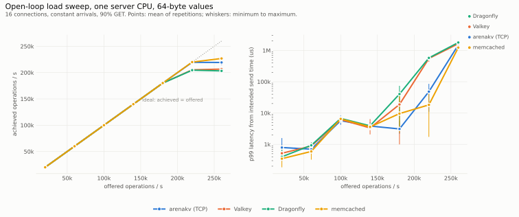
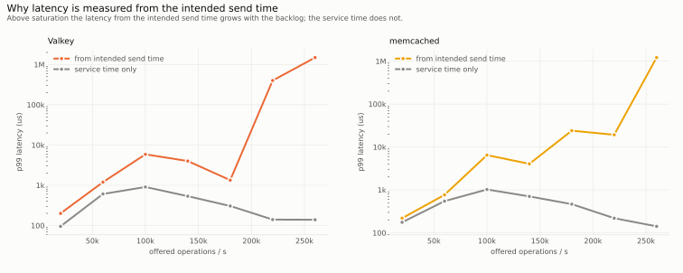

# kvpace

A load generator and measurement tool for key-value servers. It drives the RESP protocol (Redis, Valkey,
Dragonfly), the memcached text protocol and the native protocol of `arenakv` with identical workloads and
identical measurement code, in closed-loop or open-loop mode, and records the environment of every run in
its result files.

- Closed-loop and open-loop load; open-loop latency is measured from the **intended** send time.
- One connection per thread with blocking calls, or many connections per thread from one epoll loop with up to
  `--pipeline` requests in flight per connection (the client model of `memtier_benchmark -t/-c/--pipeline`).
- Operation mixes of GET, SET, DEL, INCR, MGET, read-modify-write and INSERT; YCSB core workloads A, B, C, D and F
  as presets.
- Key distributions: uniform, Zipfian, sequential, Gaussian, latest. Value sizes: fixed, uniform range or weighted
  list. Key prefixes.
- Duration or request-count runs; synchronized start on several hosts and `kvpace merge` to combine their results.
- Authentication (RESP `AUTH`, memcached ASCII authentication, native `AUTH`), RESP `SELECT`, and optional TLS for
  the RESP and memcached drivers (`TLS=1`).
- A KV-cache scenario: prefix-chain requests with reuse accounting.
- Latency histograms with at most 0.8% relative error, configurable percentiles, per-operation latencies;
  per-second throughput series; server CPU and memory sampling.
- One JSON result file per run (schema in [`docs/USAGE.md`](docs/USAGE.md#result-files)), plus CSV and
  HdrHistogram percentile-distribution output.
- CPU pinning of client threads.

**Status:** experimental. Cross-checked against `memtier_benchmark` (see [`docs/validation.md`](docs/validation.md)).

## Why this exists

Published key-value benchmark numbers are hard to compare, for three reasons. Different servers are often measured
with different tools. Closed-loop tools hide queueing delay: a request that waits behind a slow one is never sent
late, so its delay is never counted (coordinated omission). And throughput says nothing about what a cache in
front of an expensive computation actually saves. `kvpace` exists to remove these three sources of error:

- **One tool for every server.** The RESP, memcached text and arenakv native protocols share the same workload
  definitions, key generators, histograms and timing code. A difference between servers is then not a difference
  between client implementations. The results were cross-checked against `memtier_benchmark`
  ([validation](docs/validation.md)).
- **Open-loop latency from the intended send time**, reported next to the pure service time. A server that falls
  behind schedule shows it.
- **A KV-cache scenario** that models prefix chains of shared blocks, such as the key-value cache of an
  inference server. It reports the reuse rate, the fraction of needed blocks served from the cache, which measures saved
  recomputation instead of operations per second ([scenario](docs/kvcache-scenario.md)).
- **Self-describing results.** Every JSON result file records the hardware, kernel, compiler and server CPU and
  memory samples. The benchmark suite in [`../benchmarks`](../benchmarks) uses them to make every published
  number checkable.

`memtier_benchmark`, YCSB, `mutilate` and `wrk2` remain better choices for their own strengths: Redis Cluster
support and the memcached binary protocol, databases other than key-value caches, coordinated distributed load
generation, HTTP. See
[`../docs/PRIOR_ART.md`](../docs/PRIOR_ART.md).

### Comparison

| | kvpace | memtier_benchmark | YCSB |
|---|---|---|---|
| Protocols | RESP, memcached text, arenakv native | RESP, memcached text and binary | many databases through bindings |
| Same measurement code for all servers | yes | yes (two protocols) | per binding |
| Several connections per thread, pipelining | yes (`--conns-per-thread`, `--pipeline`) | yes (`-c`, `--pipeline`) | no (one request per thread) |
| Operation mix | GET, SET, DEL, INCR, MGET, read-modify-write, INSERT | GET/SET ratio, multi-get, arbitrary commands (`--command`) | read, update, insert, scan, read-modify-write |
| YCSB core workloads | A, B, C, D, F (E needs range scans) | no | A to F |
| Key distributions | uniform, Zipfian, sequential, Gaussian, latest | uniform, Zipfian, Gaussian, sequential, parallel | uniform, Zipfian, latest, hotspot, sequential |
| Value sizes | fixed, range, weighted list | fixed, range, weighted list | field count and length |
| TLS, authentication | yes (`TLS=1`) | yes | per binding |
| Open-loop arrivals | constant or Poisson schedule | per-connection rate limit | target throughput |
| Latency from the intended send time | yes, reported next to service time | no | yes (intended latency) |
| HdrHistogram output | percentile distribution files | yes | yes |
| KV-cache prefix-chain scenario with reuse accounting | yes | no | no |
| Server CPU time and memory per operation | yes (`--server-pid`) | no | no |
| Hardware and software environment in every result file | yes | no | no |
| Multi-host load generation | synchronized start, `kvpace merge` of the result files | no | separate client processes |
| Cluster-aware clients | Redis Cluster (`--driver resp-cluster`, one connection per thread) | Redis Cluster | per binding |

Statements about other systems reflect their public documentation at the time of writing.

### Measured results

Same machine for client and server, loopback, default server configurations. The tables are generated from the raw
data in [`../benchmarks/data`](../benchmarks/data) and checked by `make verify` at the repository root.

Validation against `memtier_benchmark` (Valkey, one server CPU):

<!-- BEGIN GENERATED:validation -->
Data: `benchmarks/data/2026-10-21-run3` (690 runs: 660 ok, 20 with operation errors, 0 failed, 10 skipped), commit `cb8f60b7eaa0`, summary digest `c9976f2a8da5b83b`. Mean over repetitions; `cv` is the coefficient of variation.

One server CPU, 64-byte values, 90% GET. memtier_benchmark runs `-t 1 -c 1` for one connection and `-t 4 -c 4` for 16. Latencies are GET latencies in microseconds; memtier reports milliseconds with three decimals.

| Server | Connections | kvpace client model | kvpace ops/s | memtier ops/s | Ratio | kvpace p50 | memtier p50 | kvpace p99 | memtier p99 |
|---|---|---|---|---|---|---|---|---|---|
| Valkey (RESP) | 1 | 1 thread, 1 connection | 116,950 (cv 0.7%) | 89,760 (cv 0.3%) | 1.30 | 8.4 (cv 0.4%) | 15.0 (cv 0.0%) | 11 (cv 2.4%) | 15 (cv 0.0%) |
| Valkey (RESP) | 16 | 4 threads x 4 connections | 221,077 (cv 0.5%) | 227,432 (cv 0.2%) | 0.97 | 67.3 (cv 0.4%) | 71.0 (cv 0.0%) | 134 (cv 0.4%) | 95 (cv 0.0%) |
| Valkey (RESP) | 16 | 16 threads x 1 connection | 210,438 (cv 0.9%) | 227,432 (cv 0.2%) | 0.93 | 72.8 (cv 0.6%) | 71.0 (cv 0.0%) | 139 (cv 0.8%) | 95 (cv 0.0%) |
| arenakv (memcached protocol) | 1 | 1 thread, 1 connection | 136,463 (cv 1.3%) | 102,194 (cv 0.7%) | 1.34 | 7.2 (cv 1.3%) | 15.0 (cv 0.0%) | 10 (cv 1.7%) | 15 (cv 0.0%) |
| arenakv (memcached protocol) | 16 | 4 threads x 4 connections | 296,016 (cv 0.1%) | 294,108 (cv 0.7%) | 1.01 | 49.6 (cv 0.3%) | 48.6 (cv 7.4%) | 104 (cv 0.6%) | 105 (cv 3.4%) |
| arenakv (memcached protocol) | 16 | 16 threads x 1 connection | 258,259 (cv 0.8%) | 294,108 (cv 0.7%) | 0.88 | 57.9 (cv 1.0%) | 48.6 (cv 7.4%) | 120 (cv 0.6%) | 105 (cv 3.4%) |
<!-- END GENERATED:validation -->

With memtier's client model (4 threads with 4 connections each) kvpace measures a throughput within 3% of
memtier_benchmark with 16 connections on both servers, and at least 25% more with one connection [C21]. With one
blocking thread per connection, the model of the matrix suite, it measures 5% to 15% less with 16 connections [C23].
The analysis is in [`docs/validation.md`](docs/validation.md).

Open-loop sweep over offered load, and the effect of measuring from the intended send time:

<picture>
  <source media="(prefers-color-scheme: dark)" srcset="../benchmarks/figures/sweep-dark.svg">
  
</picture>

<picture>
  <source media="(prefers-color-scheme: dark)" srcset="../benchmarks/figures/coordinated-omission-dark.svg">
  
</picture>

<!-- BEGIN GENERATED:sweep -->
Data: `benchmarks/data/2026-10-21-run3` (690 runs: 660 ok, 20 with operation errors, 0 failed, 10 skipped), commit `cb8f60b7eaa0`, summary digest `c9976f2a8da5b83b`. Mean over repetitions; `cv` is the coefficient of variation.

Open loop, one server CPU, 64-byte values, 16 connections. Latencies in microseconds, measured from the intended send time unless stated.

| System | Offered ops/s | Achieved ops/s | p50 | p99 | p99 service time | Max schedule lag (ms) |
|---|---|---|---|---|---|---|
| arenakv (TCP) | 20,000 | 20,000 (cv 0.0%) | 9 (cv 3.1%) | 175 (cv 89.8%) | 116 (cv 72.2%) | 4.2 (cv 9.5%) |
| arenakv (TCP) | 60,000 | 60,000 (cv 0.0%) | 54 (cv 42.1%) | 765 (cv 25.8%) | 494 (cv 12.0%) | 4.6 (cv 23.5%) |
| arenakv (TCP) | 100,000 | 100,001 (cv 0.0%) | 219 (cv 7.0%) | 1,915 (cv 34.1%) | 709 (cv 10.3%) | 13.6 (cv 79.4%) |
| arenakv (TCP) | 140,000 | 139,998 (cv 0.0%) | 218 (cv 25.1%) | 3,106 (cv 41.2%) | 665 (cv 14.3%) | 17.7 (cv 57.0%) |
| arenakv (TCP) | 180,000 | 179,999 (cv 0.0%) | 190 (cv 8.1%) | 2,772 (cv 15.8%) | 532 (cv 1.8%) | 17.4 (cv 88.7%) |
| arenakv (TCP) | 220,000 | 219,999 (cv 0.0%) | 122 (cv 6.2%) | 1,753 (cv 14.6%) | 346 (cv 5.7%) | 13.3 (cv 79.6%) |
| arenakv (TCP) | 260,000 | 260,015 (cv 0.0%) | 93 (cv 6.6%) | 13,310 (cv 112.6%) | 149 (cv 9.5%) | 30.1 (cv 89.1%) |
| Valkey | 20,000 | 20,000 (cv 0.0%) | 10 (cv 2.3%) | 200 (cv 55.7%) | 95 (cv 31.4%) | 4.1 (cv 14.6%) |
| Valkey | 60,000 | 60,000 (cv 0.0%) | 113 (cv 32.0%) | 1,195 (cv 62.7%) | 608 (cv 4.6%) | 14.3 (cv 110.0%) |
| Valkey | 100,000 | 100,000 (cv 0.0%) | 341 (cv 10.7%) | 5,865 (cv 17.5%) | 906 (cv 4.3%) | 25.9 (cv 89.3%) |
| Valkey | 140,000 | 140,004 (cv 0.0%) | 172 (cv 2.4%) | 3,994 (cv 58.6%) | 535 (cv 1.3%) | 64.8 (cv 69.6%) |
| Valkey | 180,000 | 180,016 (cv 0.0%) | 99 (cv 3.5%) | 1,339 (cv 30.1%) | 305 (cv 2.5%) | 27.9 (cv 92.1%) |
| Valkey | 220,000 | 210,520 (cv 0.9%) | 242,011 (cv 11.4%) | 400,975 (cv 15.2%) | 140 (cv 1.0%) | 418.5 (cv 14.1%) |
| Valkey | 260,000 | 211,542 (cv 0.4%) | 927,780 (cv 2.2%) | 1,488,139 (cv 2.1%) | 139 (cv 0.6%) | 1,521.3 (cv 2.8%) |
| Dragonfly | 20,000 | 20,000 (cv 0.0%) | 10 (cv 6.1%) | 385 (cv 68.7%) | 222 (cv 61.6%) | 3.5 (cv 10.9%) |
| Dragonfly | 60,000 | 60,004 (cv 0.0%) | 87 (cv 42.6%) | 1,098 (cv 33.7%) | 550 (cv 9.9%) | 29.2 (cv 27.4%) |
| Dragonfly | 100,000 | 99,995 (cv 0.0%) | 498 (cv 8.8%) | 7,759 (cv 12.8%) | 880 (cv 7.2%) | 52.1 (cv 69.0%) |
| Dragonfly | 140,000 | 140,003 (cv 0.0%) | 263 (cv 3.6%) | 4,912 (cv 25.9%) | 478 (cv 11.5%) | 47.3 (cv 101.7%) |
| Dragonfly | 180,000 | 180,005 (cv 0.0%) | 168 (cv 31.9%) | 38,676 (cv 130.1%) | 192 (cv 15.4%) | 64.9 (cv 98.6%) |
| Dragonfly | 220,000 | 210,165 (cv 0.7%) | 241,172 (cv 9.8%) | 406,428 (cv 8.5%) | 95 (cv 3.3%) | 413.6 (cv 7.8%) |
| Dragonfly | 260,000 | 210,926 (cv 0.4%) | 957,140 (cv 2.1%) | 1,533,438 (cv 2.4%) | 95 (cv 3.6%) | 1,568.5 (cv 3.1%) |
| memcached | 20,000 | 20,000 (cv 0.0%) | 9 (cv 3.1%) | 219 (cv 11.4%) | 176 (cv 23.4%) | 3.5 (cv 17.0%) |
| memcached | 60,000 | 60,000 (cv 0.0%) | 77 (cv 49.4%) | 766 (cv 10.6%) | 546 (cv 12.1%) | 14.9 (cv 54.7%) |
| memcached | 100,000 | 99,999 (cv 0.0%) | 358 (cv 14.1%) | 6,455 (cv 25.2%) | 1,022 (cv 2.4%) | 43.7 (cv 66.3%) |
| memcached | 140,000 | 140,004 (cv 0.0%) | 272 (cv 4.8%) | 4,044 (cv 27.7%) | 704 (cv 2.4%) | 31.9 (cv 118.6%) |
| memcached | 180,000 | 179,895 (cv 0.1%) | 177 (cv 6.3%) | 23,976 (cv 118.5%) | 465 (cv 5.8%) | 95.9 (cv 65.8%) |
| memcached | 220,000 | 220,006 (cv 0.1%) | 104 (cv 4.4%) | 19,238 (cv 96.7%) | 219 (cv 8.0%) | 48.0 (cv 65.9%) |
| memcached | 260,000 | 229,650 (cv 3.0%) | 554,068 (cv 24.2%) | 1,212,154 (cv 15.5%) | 141 (cv 7.3%) | 1,311.2 (cv 15.9%) |
<!-- END GENERATED:sweep -->

- Up to 140,000 offered operations per second all four servers achieve the offered rate within 1% [C8].
- At 260,000 offered operations per second, p99 latency measured from the intended send time is more than 1,000
  times the p99 service time for Valkey, Dragonfly and memcached, which do not sustain that rate [C7] [C9]. A closed-loop or service-time-only tool would not show this
  backlog.

## Requirements

Linux, a C compiler with `-std=gnu2x` (gcc 13 or newer, clang 18 or newer), `make`, pthreads, libm. The native
driver for `arenakv` additionally needs `../arenakv` and `../rdmaduct` (built automatically; override the locations
with `AKV_DIR` and `DUCT_DIR`, or build without it with `NATIVE=0`).

## Build and test

```
make                 # build/<arch>/kvpace
make test            # unit tests: histogram, generators, drivers, runner timing, merge, KV-cache workload
make SAN=1 test      # AddressSanitizer + UndefinedBehaviorSanitizer
make TLS=1 test      # with TLS for the text drivers (OpenSSL), build/<arch>-tls/
make NATIVE=0        # without the arenakv driver
make RDMA=0          # native driver over TCP only (build/<arch>-tcp/)
sudo make install    # /usr/local/bin/kvpace (PREFIX= and DESTDIR= are honored)
```

Test results: all ten suites pass on x86-64, in the default, `TLS=1`, `RDMA=0` and `NATIVE=0` builds and under
AddressSanitizer with UndefinedBehaviorSanitizer (with and without TLS). CI runs them with gcc and clang on x86-64
and arm64, and the TLS build on x86-64.

| Suite | Covers |
|---|---|
| `test_hist` | exact storage of small values, bucket bounds, relative quantization error over the 64-bit range, quantiles, merge |
| `test_zipf` | empirical rank frequencies against the exact Zipf probabilities, uniformity at theta 0, range |
| `test_workload` | parsing of mixes, sizes and presets; operation frequencies; sequential, Gaussian, latest and Zipf keys; value-size bounds and frequencies; key text |
| `test_resp`, `test_memcached` | drivers against in-process servers: round trips, missing keys, binary-safe and empty values, oversize values |
| `test_drivers` | all three drivers against an in-process arenakv server: DEL, INCR, MGET, authentication, and pipelined asynchronous requests compared with the synchronous results |
| `test_runner` | closed- and open-loop timing with a synthetic driver whose throughput and latency are known analytically, for one and for several connections per thread with pipelining; request-count mode |
| `test_merge` | JSON round trip, `kvpace merge` (summed counters and series, merged histograms, idempotent percentiles, schema check), CSV and `.hgrm` output |
| `test_tls` | TLS round trips and 200 pipelined requests with certificate verification, refusal of an untrusted certificate, `--tls-skip-verify` (`TLS=1` builds) |
| `test_kvcache` | request structure, hit rates, determinism, key sharing and separation, corruption detection |

## Quick start

Start a server (any of the supported protocols), then:

```
# closed loop: 16 connections, 64-byte values, 90% GET, 10 s after 2 s warm-up
build/x86_64/kvpace --port 6379 --threads 16 --duration 10 --value-size 64 --read-ratio 0.9 \
    --pin 8,10,12,14 --label "valkey 9" --out result.json

# open loop: 100,000 operations per second in total, constant arrivals
build/x86_64/kvpace --port 6379 --threads 16 --rate 100000 --duration 10 --out result.json

# memtier-style client: 4 threads x 4 connections, 8 requests in flight per connection, SET:GET 1:10
build/x86_64/kvpace --port 6379 --threads 4 --conns-per-thread 4 --pipeline 8 --ratio 1:10 --out result.json

# YCSB workload A (50% read, 50% update, Zipfian, 1000-byte values) over TLS with a password
build/x86_64-tls/kvpace --port 6380 --tls --cacert ca.pem --auth secret --workload ycsb-a --threads 8

# two load-generator hosts started together, results combined afterwards
build/x86_64/kvpace --host 192.0.2.10 --threads 8 --start-at 1793000000 --out a.json    # on each host
build/x86_64/kvpace merge --out all.json a.json b.json

# KV-cache scenario against a memcached server
build/x86_64/kvpace --driver memcached --port 11211 --scenario kvcache --threads 8 --block-size 16384

# native protocol of arenakv over RDMA
build/x86_64/kvpace --driver native --driver-opt transport=rdma --host 192.0.2.10 --port 7600
```

The text output prints throughput, latency percentiles per operation type and, with `--server-pid`, the server's
CPU time per operation and resident memory. `kvpace --help` lists every option.

## Options

The main options; `kvpace --help` prints the complete list.

| Option | Default | Meaning |
|---|---|---|
| `--driver NAME` | `resp` | `resp`, `memcached`, `native` |
| `--driver-opt K=V` | | driver option, repeatable; `native`: `transport=tcp\|rdma\|auto`, `wait=poll\|event`, `max-msg=N`, `depth=N` |
| `--host`, `--port` | `127.0.0.1`, `6379` | server address |
| `--threads N` | 1 | client threads |
| `--conns-per-thread N`, `--pipeline N` | 1, 1 | connections per thread; requests in flight per connection |
| `--auth SECRET`, `--db N` | | password or `user:password`; RESP database |
| `--tls`, `--cacert`, `--cert`, `--key`, `--sni`, `--tls-skip-verify` | off | TLS for `resp` and `memcached` (`TLS=1` builds) |
| `--duration SEC`, `--warmup SEC` | 10, 2 | measurement and warm-up length |
| `--requests N` | | requests per connection instead of a duration (no warm-up) |
| `--start-at UNIXTIME` | | start the warm-up at this time after the preload |
| `--keys N`, `--key-prefix TEXT` | 100000, `k` | key space size (preloaded unless `--no-preload`); key prefix |
| `--dist NAME`, `--theta X`, `--gauss-sd X` | `uniform`, 0.99, 1/6 | `uniform`, `zipf`, `sequential`, `gaussian`, `latest` |
| `--value-size SPEC` | 64 | `N`, `A-B` or `S:W,S:W,...` |
| `--read-ratio X`, `--ratio SET:GET`, `--mix SPEC` | 0.9 | operation mix, for example `--mix get=80,set=15,del=3,incr=2` |
| `--multi-get N` | 1 | keys per MGET |
| `--workload NAME` | | `ycsb-a`, `ycsb-b`, `ycsb-c`, `ycsb-d`, `ycsb-f` |
| `--rate N`, `--arrival NAME`, `--spin` | 0, `constant` | open loop: aggregate operations per second, `constant` or `poisson`, busy-wait |
| `--scenario NAME` | `kv` | `kv` or `kvcache` (parameters: `--block-size`, `--groups`, `--shared-blocks`, `--turn-blocks`, `--active-conv`, `--max-turns`, `--new-conv-prob`) |
| `--server-pid PID` | | sample the server's CPU time and resident memory |
| `--pin LIST` | | CPU list for client threads (thread i uses entry i mod length) |
| `--label TEXT`, `--out FILE` | | name stored in the result; JSON output path |
| `--csv FILE`, `--hdr-prefix PREFIX`, `--percentiles LIST` | 50,90,99,99.9,99.99 | CSV summary; HdrHistogram files; reported percentiles |
| `--seed N`, `--no-preload` | 1 | random seed; skip the preload |

The exit status is 0 on success, 1 on setup failure, 2 on invalid options and 3 when some operations failed (the
result is still written).

## Measurement model in one paragraph

With one connection per thread and no pipelining, each thread has one request in flight and calls the driver
synchronously. Otherwise each thread serves its connections from one epoll loop and keeps up to `--pipeline`
requests in flight on each. In the open loop requests follow a schedule; a request that cannot be sent at its
intended time, because the connection is busy or the generator is behind, is sent as soon as possible and the
delay counts as latency, because latency is measured from the intended send time (the pure service time is
reported separately). Warm-up operations are not recorded. Throughput is completed operations divided by the
measurement time. Definitions of all metrics: [`../benchmarks/METHODOLOGY.md`](../benchmarks/METHODOLOGY.md).

## Helper scripts

| Script | Purpose |
|---|---|
| `scripts/servers.sh` | starts and stops the systems under test (containers or native `arenakvd`), with a capacity setting |
| `scripts/env.sh` | CPU assignment used by the benchmark suite |

The benchmark suite in [`../benchmarks`](../benchmarks) orchestrates these for the published measurements.

## Limitations

- No cluster-aware clients (Redis Cluster, consistent hashing over several servers) and no memcached binary
  protocol.
- The KV-cache scenario uses the synchronous model (one connection per thread).
- The native driver has no TLS; its RDMA transport is not encrypted.
- Keys are the prefix followed by 15 digits; the prefix is at most 32 bytes.
- `kvpace merge` adds throughput and merges histograms; it does not check that the inputs ran at the same time.
- Server CPU sampling has the 10 ms granularity of `/proc` and needs the server's host PID.

## Layout

| Path | Content |
|---|---|
| `src/` | tool and library code (`runner`, `workload`, `hist`, `zipf`, `kvcache`, drivers, `sock`, `report`, `json`, `merge`, `main`) |
| `tests/` | unit tests |
| `scripts/` | helper scripts |
| `docs/` | usage, architecture, scenario and validation documents |

## Further reading

[Usage, option reference and result schema](docs/USAGE.md) · [Running the benchmark suite](../benchmarks/RUNNING.md) ·
[Architecture](docs/ARCHITECTURE.md) ·
[KV-cache scenario](docs/kvcache-scenario.md) · [Validation against memtier](docs/validation.md) ·
[Methodology](../benchmarks/METHODOLOGY.md)
