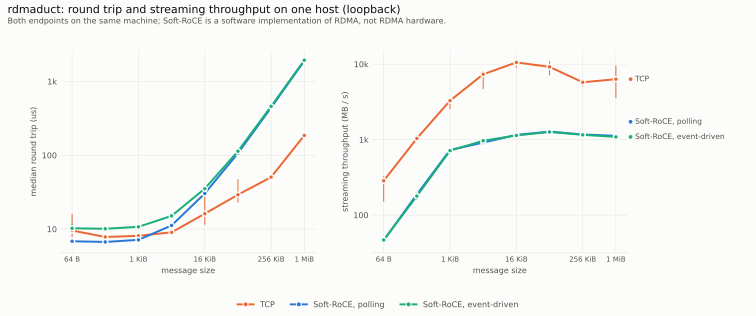

# rdmaduct

A small C library for communication between two endpoints over **RDMA reliable connections** or **TCP**, with
the same API and the same behavior on both.

- Two-sided messages: reliable, ordered, message-preserving delivery; a message is received whole or not at all.
- Registered memory regions, zero-copy sends from them, and one-sided **RDMA READ, WRITE and 64-bit atomics**
  (fetch-and-add, compare-and-swap) on a peer's region. On TCP the peer's library emulates them.
- Posted operations with sequence numbers, so many operations are in flight behind one wait.
- **Event-loop integration:** every endpoint and listener has a pollable descriptor, so thousands of connections
  can share one epoll loop.
- Credit-based flow control on RDMA: a sender never overruns the receiver's posted buffers.
- Blocking calls with timeouts; polling or event-driven waiting for RDMA endpoints.
- Batched sends: one doorbell per up to 16 messages on RDMA, one `sendmsg()` per up to 32 messages on TCP; buffered
  TCP reads, so pipelined small messages cost a fraction of a system call each.
- Builds without RDMA libraries (`make RDMA=0`) for machines without RDMA hardware.
- Tested for faults and malformed input (see [Testing](#testing)).

- Optional encryption (`TLS=1`, OpenSSL 3): a TLS 1.3 handshake inside the first messages, then AES-256-GCM per
  message, on both transports; see [Encryption](#encryption).

**Status:** experimental. The API may change before a first release. Encryption is optional and has not been
reviewed by an outside party.

## Why this exists

RDMA programming with libibverbs and librdmacm is verbose and full of failure modes: queue pair state machines,
receive buffers that must be posted before the peer sends, completion errors that only appear under load. The
established frameworks (UCX, libfabric) solve this and much more, but they are large toolkits whose capabilities
and behavior vary with the transport or provider in use. Applications that only need reliable messages face a
choice between hand-written verbs code and a framework far bigger than the problem.

`rdmaduct` is a deliberately small middle ground:

- **One API, identical semantics on RDMA and TCP.** Messages, one-sided operations, atomics, ordering, flow
  control, timeouts and the error model are the same on both transports, and the same test suites run unchanged
  on both. Code developed on a machine without RDMA hardware behaves the same on an RDMA cluster.
- **Flow control that cannot overrun the receiver.** Credits track the peer's posted buffers. A test with a slow
  consumer checks the device's receiver-not-ready counters.
- **Failure paths tested, not assumed:** two million fuzzed handshakes, a raw socket that attacks the TCP
  framing, abrupt closes in both waiting modes, and descriptor-leak checks over connect/disconnect cycles.
- **Small dependency set:** libc and pthreads for TCP; libibverbs and librdmacm for RDMA. About 3,800 lines with
  headers.

It does not do GPU memory, multi-rail, tag matching or collectives. For those, use UCX, libfabric or MPI
([`../docs/PRIOR_ART.md`](../docs/PRIOR_ART.md)).

### Comparison

| | rdmaduct | UCX | libfabric | rsocket (librdmacm) |
|---|---|---|---|---|
| Programming model | two-sided messages, RMA read/write, atomics | tag matching, streams, active messages, RMA, atomics | messages, tagged messages, RMA, atomics | stream sockets |
| Transports | RDMA reliable connections, TCP | many (verbs, shared memory, TCP, GPU) | many providers (verbs, TCP, shared memory, EFA, CXI) | RDMA |
| Same semantics on every transport | yes; one test suite runs on both | capabilities depend on the transport | capabilities depend on the provider | single transport |
| Message boundaries preserved | yes | yes | yes | no (byte stream) |
| One-sided read/write and 64-bit atomics | yes (emulated on TCP) | yes | yes | write only (`riowrite`) |
| Zero-copy send from registered memory | yes | yes | yes | no |
| Pollable descriptor for event loops | yes (endpoint and listener) | yes (worker) | yes (wait sets) | `rpoll()`, not epoll |
| GPU memory, multi-rail, tag matching | no | yes | yes | no |
| Source size | about 3,800 lines | large framework | large framework | part of librdmacm |

Statements about other systems reflect their public documentation at the time of writing.

### Measured results

Loopback on one host: both endpoints on the same machine, RDMA through Soft-RoCE (software RDMA, not RDMA
hardware). Tables are generated from the raw data in [`../benchmarks/data`](../benchmarks/data) and checked by
`make verify` at the repository root.

<picture>
  <source media="(prefers-color-scheme: dark)" srcset="../benchmarks/figures/transport-dark.svg">
  
</picture>

<!-- BEGIN GENERATED:transport-rtt -->
Data: `benchmarks/data/2026-10-23-run5` (790 runs: 754 ok, 26 with operation errors, 0 failed, 10 skipped), commit `9054e10aa2ab`, summary digest `8262d6bae955c711`. Mean over repetitions; `cv` is the coefficient of variation.

Median round-trip time in microseconds (ping-pong, one message in flight). Loopback on one host.

| Message bytes | TCP | Soft-RoCE, polling | Soft-RoCE, event-driven |
|---|---|---|---|
| 64 | 7.4 (cv 3.2%) | 6.9 (cv 5.2%) | 10.4 (cv 7.2%) |
| 256 | 7.5 (cv 2.6%) | 6.7 (cv 2.7%) | 10.4 (cv 4.7%) |
| 1024 | 7.7 (cv 4.6%) | 7.1 (cv 3.1%) | 11.2 (cv 7.5%) |
| 4096 | 8.5 (cv 2.4%) | 11.4 (cv 1.8%) | 15.3 (cv 2.9%) |
| 16384 | 10.8 (cv 3.7%) | 30.5 (cv 0.9%) | 35.9 (cv 1.7%) |
| 65536 | 22.7 (cv 1.2%) | 109.5 (cv 3.1%) | 114.0 (cv 5.3%) |
| 262144 | 48.9 (cv 3.4%) | 451.7 (cv 3.1%) | 454.2 (cv 0.8%) |
| 1048576 | 181.0 (cv 1.4%) | 1,889.5 (cv 0.8%) | 1,932.7 (cv 1.1%) |
<!-- END GENERATED:transport-rtt -->

<!-- BEGIN GENERATED:transport-stream -->
Data: `benchmarks/data/2026-10-23-run5` (790 runs: 754 ok, 26 with operation errors, 0 failed, 10 skipped), commit `9054e10aa2ab`, summary digest `8262d6bae955c711`. Mean over repetitions; `cv` is the coefficient of variation.

One-way streaming throughput in MB/s (batched sends, 64 buffers per direction). Loopback on one host.

| Message bytes | TCP | Soft-RoCE, polling | Soft-RoCE, event-driven |
|---|---|---|---|
| 64 | 315 (cv 2.7%) | 46 (cv 5.7%) | 44 (cv 5.3%) |
| 256 | 1,161 (cv 4.0%) | 187 (cv 6.5%) | 167 (cv 10.1%) |
| 1024 | 3,137 (cv 11.1%) | 703 (cv 9.7%) | 679 (cv 5.6%) |
| 4096 | 7,913 (cv 5.9%) | 898 (cv 4.4%) | 935 (cv 2.0%) |
| 16384 | 10,631 (cv 12.8%) | 1,130 (cv 0.9%) | 1,139 (cv 1.1%) |
| 65536 | 10,538 (cv 8.1%) | 1,293 (cv 1.6%) | 1,284 (cv 0.5%) |
| 262144 | 6,007 (cv 4.6%) | 1,176 (cv 2.9%) | 1,176 (cv 1.2%) |
| 1048576 | 8,037 (cv 16.8%) | 1,118 (cv 1.6%) | 1,091 (cv 0.9%) |
<!-- END GENERATED:transport-stream -->

- For messages up to 1 KiB the median round trip of Soft-RoCE with polling is lower than that of TCP; from 16 KiB TCP
  is lower than both Soft-RoCE modes [C19].
- TCP loopback streaming is at least four times faster than both Soft-RoCE modes at every measured size [C20]. TCP
  copies the frames of a batch up to 512 bytes into one staging buffer and writes it with one `send()` (larger
  payloads go out in place with `sendmsg()`), and reads through a 64 KiB buffer, so small streamed messages cost a
  fraction of a system call each.
- These numbers describe the cost of a software RDMA implementation on one host. They say nothing about RDMA
  hardware, where the data path bypasses the kernel.

## Requirements

- Linux, a C compiler with `-std=gnu2x` (gcc 13 or newer, clang 18 or newer), `make`, pthreads.
- For encryption (`TLS=1`): OpenSSL 3 (`libssl-dev`).
- For RDMA: `libibverbs-dev` and `librdmacm-dev` (Debian/Ubuntu names) and an RDMA device. Soft-RoCE
  (`rdma_rxe`) works for development: `sudo modprobe rdma_rxe && sudo rdma link add rxe0 type rxe netdev <interface>`.
- Python 3 is not required.

## Build

```
make                 # build/<arch>/librdmaduct.a, duct_echo, duct_bench, examples
make RDMA=0          # TCP transport only: needs only libc and pthreads
make SAN=1 test      # AddressSanitizer + UndefinedBehaviorSanitizer
make TLS=1           # with encrypted endpoints (OpenSSL)
```

`RDMA=0` builds go to `build/<arch>-tcp/`, `TLS=1` builds to a directory with the suffix `-tls`; link `TLS=1`
builds with `-lssl -lcrypto` as well.

Link with `build/<arch>/librdmaduct.a -lpthread` and, for RDMA builds, `-lrdmacm -libverbs`. Include path:
`include/`.

## Quick start

Server (`examples/hello_server.c`) and client (`examples/hello_client.c`):

```
build/x86_64/hello_server tcp 7800 &
build/x86_64/hello_client tcp 127.0.0.1 7800 abc "rdma transport"
# abc -> cba
# rdma transport -> tropsnart amdr
```

Use `rdma` instead of `tcp` on both sides to select RDMA; the host argument of the client must then be the IPv4
address of an interface that carries an RDMA device. The core of a client:

```c
struct duct_opts opts;
duct_opts_default(&opts);                 /* AUTO transport, 64 KiB messages, 32 buffers */
duct_ctx *ctx;
duct_ctx_create(&opts, &ctx);

duct_ep *ep;
duct_connect(ctx, "192.0.2.10", "7800", &ep);
duct_send(ep, "ping", 4, 1000);           /* timeout in milliseconds */

struct duct_rx rx;
duct_recv(ep, &rx, 1000);                 /* rx.data and rx.len are valid until released */
duct_rx_release(ep, &rx);

duct_ep_close(ep);
duct_ctx_destroy(ctx);
```

## Concepts

| Object | Meaning |
|---|---|
| context (`duct_ctx`) | options and shared state (RDMA device, protection domain); create one per process or per thread group |
| listener (`duct_listener`) | accepts incoming connections |
| endpoint (`duct_ep`) | one connection; used by one thread at a time |
| received message (`struct duct_rx`) | borrowed from the transport until `duct_rx_release()` |

## API summary

Full contracts are in [`include/rdmaduct.h`](include/rdmaduct.h).

| Function | Purpose |
|---|---|
| `duct_opts_default`, `duct_ctx_create`, `duct_ctx_destroy`, `duct_ctx_transport` | configure and create a context |
| `duct_listen`, `duct_listener_port`, `duct_accept`, `duct_listener_close` | server side |
| `duct_connect`, `duct_ep_close`, `duct_ep_peer_max_msg` | client side and endpoint management |
| `duct_send`, `duct_send_batch`, `duct_send_some` | send one message or a batch (copying); `duct_send_some` sends what fits without waiting and returns the count |
| `duct_recv`, `duct_rx_release` | receive a message and return its buffer |
| `duct_ep_fd`, `duct_ep_arm`, `duct_progress`, `duct_ep_send_space`, `duct_listener_fd` | event-loop integration |
| `duct_ep_direct_fd`, `duct_ep_wait_events` | direct waiting on the transport descriptor (TCP: the socket), without a nested epoll set |
| `duct_mr_reg`, `duct_mr_dereg`, `duct_mr_export`, `duct_mr_addr` | registered regions and their descriptors |
| `duct_send_mr` | zero-copy send of part of a region |
| `duct_read`, `duct_write`, `duct_atomic_fadd`, `duct_atomic_cswap` | one-sided operations on a peer's region |
| `duct_ep_completed`, `duct_wait` | completion of posted operations |
| `duct_strerror` | text of an error code |

### Event loop

```c
/* add duct_ep_fd(ep) to an epoll set for EPOLLIN, then: */
for (;;) {
    struct duct_rx rx;
    while (duct_recv(ep, &rx, 0) == 0) {          /* drain without blocking */
        handle(rx.data, rx.len);
        duct_rx_release(ep, &rx);
    }
    if (duct_ep_arm(ep) == -EAGAIN) {
        continue;                                 /* work arrived while arming */
    }
    break;                                        /* wait for epoll to report the descriptor */
}
```

### One-sided operations

```c
/* target */
duct_mr *mr;
duct_mr_reg(ctx, buf, len, DUCT_ACCESS_REMOTE_READ | DUCT_ACCESS_REMOTE_WRITE, &mr);
struct duct_mr_desc d;
duct_mr_export(mr, &d);
duct_send(ep, &d, sizeof(d), 1000);               /* the descriptor travels as an ordinary message */

/* initiator (local region lmr registered with DUCT_ACCESS_LOCAL) */
uint64_t seq;
duct_read(ep, lmr, 0, &d, 4096, 65536, 1000, &seq);   /* 64 KiB from offset 4096 of the target region */
duct_wait(ep, seq, 1000);
```

On TCP the target's library executes the operation while the target application calls any function on that
endpoint (`duct_recv`, `duct_progress`, an event loop); on RDMA the network adapter executes it without the
target's CPU.

### Options (`struct duct_opts`)

| Field | Default | Meaning |
|---|---|---|
| `transport` | `DUCT_TRANSPORT_AUTO` | `TCP`, `RDMA`, or `AUTO` (RDMA when built with RDMA support and a device exists) |
| `max_msg` | 64 KiB | largest message this side accepts; receive buffers have this size |
| `recv_depth` | 32 | receive buffers per endpoint; also the number of unreleased messages the peer may have in flight (RDMA) |
| `send_depth` | 32 | send buffers per endpoint (RDMA) |
| `connect_timeout_ms` | 10000 | connection setup timeout; `-1` waits indefinitely |
| `wait` | `DUCT_WAIT_POLL` | RDMA waiting: spin on the completion queue, or sleep until an event |
| `tls` | 0 | 1 encrypts every endpoint of the context (`TLS=1` builds; otherwise `duct_ctx_create` returns `-ENOTSUP`) |
| `tls_cert`, `tls_key` | NULL | PEM certificate chain and key: required to listen; sent as client certificate when connecting |
| `tls_ca` | NULL | PEM CA bundle: the connecting side verifies the server against it, the listening side requires client certificates signed by it; NULL verifies nothing |
| `tls_server_name` | NULL | name or address the server certificate must match; NULL uses the address passed to `duct_connect` |

The effective send limit of an endpoint is the smaller of the local and the peer's `max_msg`.

### Behavior guarantees

- Messages arrive in the order sent, whole, or the endpoint fails.
- `duct_send` copies the data; the caller's buffer is reusable on return.
- An endpoint may hold up to `recv_depth` received messages unreleased, on both transports.
- Posted operations complete in posting order; `duct_ep_completed()` is cumulative.
- Timeouts return `-ETIMEDOUT` and leave the endpoint usable; a timed-out send has sent nothing. Arguments that are
  invalid by local information return `-EINVAL` and also leave it usable. Every other transport error is sticky:
  the endpoint must be closed.
- Messages received before a disconnect are delivered before `DUCT_ECLOSED` is reported.
- `duct_ep_close` waits (at most one second) for sends in flight, so a message sent just before closing is not lost.
- A peer that stops releasing received messages stalls the sender (flow control); it does not cause errors.

### Error codes

Negative `errno` values (`-ETIMEDOUT`, `-EMSGSIZE`, `-ECONNREFUSED`, ...) and `DUCT_ECLOSED` (peer closed),
`DUCT_EPROTO` (protocol violation), `DUCT_EWC` (RDMA work completion error), `DUCT_ENODEV` (no usable RDMA device),
`DUCT_EACCESS` (a one-sided operation violated the remote region's range or rights).

## Encryption

With `tls = 1` both sides of every connection of the context run a TLS 1.3 handshake (OpenSSL) inside their first
rdmaduct messages. The connecting side completes it inside `duct_connect()`; an accepted endpoint is returned at
once and completes it inside `duct_recv()`, `duct_progress()` and `duct_ep_arm()`, so that one slow client cannot
hold up the thread that accepts; a handshake that does not finish within `connect_timeout_ms` fails with
`DUCT_EPROTO`. Then each direction encrypts every message with AES-256-GCM, keyed from the TLS exporter
(RFC 8446, section 7.5), with the message number as nonce and a new key after every 2^24 messages (RFC 8446,
section 5.5). Each message carries 17 bytes more (a type byte and the 16-byte tag), so `duct_ep_peer_max_msg()` is
17 bytes smaller. Messages are encrypted while they are copied into the send buffer and decrypted in place in the
receive buffer. A message that fails authentication breaks the endpoint (`DUCT_EPROTO`).

Not available on encrypted endpoints (`-ENOTSUP`): `duct_send_mr()`, one-sided reads, writes and atomics, and
`duct_wait()`. A one-sided operation is executed by the peer's network adapter without the peer's CPU, so it cannot
be encrypted this way. Both sides must set `tls`: an unencrypted peer fails with `DUCT_EPROTO`. Without `tls_ca`
the peer is not verified, which leaves the connection open to an active man in the middle.

The record format and state machine are in [`docs/ARCHITECTURE.md`](docs/ARCHITECTURE.md#encrypted-endpoints).

## Waiting modes

| Mode | CPU while idle | Wake-up latency | Use when |
|---|---|---|---|
| `DUCT_WAIT_POLL` | one core busy per waiting thread | lowest | each waiting thread has its own core |
| `DUCT_WAIT_EVENT` | none | a few microseconds more; credit updates are re-checked every 200 µs | more waiting threads than cores, or idle connections |

Measurements of both modes are in [Measured results](#measured-results).

## Tools

| Tool | Purpose |
|---|---|
| `duct_echo` | echo server and round-trip client for manual tests |
| `duct_bench` | latency and throughput benchmark used by `benchmarks/` (see `tools/duct_bench.c`) |

## Testing

```
make test                                  # unit, TCP, fault-injection and (if a device exists) RDMA suites
DUCT_TEST_ADDR=<rdma-interface-ip> make test   # select the RDMA address explicitly
DUCT_STRESS_COUNT=100000000 make test-rdma     # long streaming stress
```

The suites cover the handshake codec (including two million fuzzed inputs), TCP framing and control frames
attacked through a raw socket (oversize frames, split frames, truncation, garbage, random emulated requests),
flow control under a slow consumer with a check that the device reports no receiver-not-ready errors, 64
connections through one epoll loop without missed wake-ups, one-sided operations and atomics including remote
access violations, abrupt close in both waiting modes, asymmetric limits, connect/disconnect cycles with a
descriptor-leak check, and the examples. Details:
[`docs/ARCHITECTURE.md`](docs/ARCHITECTURE.md#testing).

Test results: all suites pass on x86-64 and aarch64, including the RDMA suite over Soft-RoCE in both waiting modes.
On x86-64 they also pass under AddressSanitizer with UndefinedBehaviorSanitizer. CI runs the TCP suites with gcc
and clang on x86-64 and arm64.

| Suite | Covers |
|---|---|
| `test_hello` | handshake encoding and validation, two million fuzzed inputs |
| `test_tcp` | echo suite over TCP on loopback |
| `test_rdma` | the same echo suite over RDMA, receiver-not-ready counter check under a slow consumer |
| `test_poll` | 64 connections per side driven by one epoll set per side with non-blocking sends; fails on any missed wake-up |
| `test_mr` | write/read back up to 256 KiB, 64 pipelined writes, fetch-and-add and compare-and-swap, zero-copy send, local validation, `DUCT_EACCESS` for forged and deregistered regions |
| `test_faults` | TCP framing, handshake and 1500 random control frames attacked through a raw socket; accept timeout, refused connections, asymmetric limits, abrupt close |
| `test_tls` | encrypted endpoints (`TLS=1`): every message size, batches, a server that waits in `poll()`, verification by address and by name, wrong CA, wrong name, client certificates, unencrypted peers, a changed ciphertext byte, a handshake that never starts, key updates every five messages, refused operations; over TCP, and over RDMA in both waiting modes when `DUCT_TEST_ADDR` is set |
| `run_examples.sh` | the example server and client |

## Limitations

- An endpoint is used by one thread at a time; many endpoints can share one thread through their descriptors.
- No multiple NICs, no GPU memory, no tag matching or collectives.
- Received messages land in the endpoint's buffers (no zero-copy receive); `duct_send_mr` avoids the send copy.
- On TCP, one-sided operations progress only while the target application calls into the library on that endpoint.
- Without `tls` nothing is encrypted or authenticated. With `tls`, registered-memory sends and one-sided operations
  are not available, and the encryption code has not been reviewed by an outside party.
- Received-completion visibility after a peer disconnect is handled with a short grace period (see
  `docs/ARCHITECTURE.md`); the underlying cause was not identified.
- Performance numbers exist only for Soft-RoCE and TCP on Ethernet; there are none for RDMA hardware.

## Layout

| Path | Content |
|---|---|
| `include/rdmaduct.h` | public API |
| `src/` | implementation (`duct.c` dispatch and validation, `tcp.c`, `rdma.c`, `hello.c` wire codecs, `internal.h`) |
| `tools/` | `duct_echo`, `duct_bench` |
| `examples/` | `hello_server`, `hello_client` |
| `tests/` | test suites |
| `docs/` | architecture and protocol documentation |

## Further reading

- [Architecture and protocol](docs/ARCHITECTURE.md)
- [Contributing](../CONTRIBUTING.md), [Security notes](../SECURITY.md)
